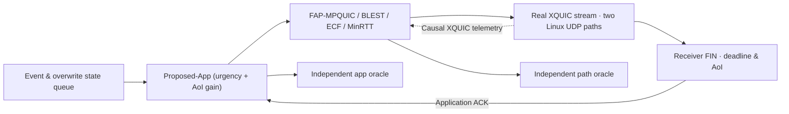

# IoT-MPQUIC-Scheduler

**English** | [简体中文](README.zh-CN.md)

**Freshness- and stall-aware Multipath QUIC scheduling for deadline-constrained IoT traffic on a real production `XQUIC` stack.**

IoT-MPQUIC-Scheduler multiplexes sporadic hard-deadline alarm events and overwriteable periodic sensor state updates over a single encrypted Multipath QUIC (`XQC_MULTIPATH_10` + `BoringSSL`) connection spanning two real Linux UDP paths (`ip netns` + `tc-netem`). It introduces **`FAP-MPQUIC`** (`fresh-aware`), a lightweight zero-control-overhead C scheduler that combines overwrite-freshness queue scheduling, CWND-blocking-aware timely delivery estimation, and health-gated stale-path freshness probing.

[Overview](#overview) · [Architecture](#architecture-and-scheduling-design) · [Results](#real-xquic-dual-path-evaluation) · [Quick Start](#quick-start) · [Reproduce](#reproduce-the-experiments) · [IEEE Paper (PDF)](papers/iot-mpquic-scheduler/manuscript.pdf)

---

## Overview

Classical multipath schedulers—such as native `MinRTT`, `ECF`, and `BLEST`—rank paths using cached RTT and drain time without modeling deadline slack, packet loss, overwriteable Age of Information (AoI), or stale-RTT blindness on idle backup paths. When a gateway's primary link suffers an asymmetric reversal or silent blackout, classical schedulers remain trapped on the degraded path and miss urgent IoT deadlines.

Across **1,596+ audited real `XQUIC` connections** (including a **576-connection held-out benchmark** across 4 dynamic dual-path regimes × 16 seeds × 9 policies, dual-interface PCAP captures, and independent replay Oracles), `FAP-MPQUIC` achieves:

- **+20.6 to +52.1 pp higher event deadline delivery** than `FIFO+MinRTT`, `App+MinRTT`, `Fixed-MinRTT`, `ECF`, and `BLEST` under high-load outage-reversal and mid-connection Path-A blackouts ($p_{\text{Holm}} \le 0.0230$, Cohen's $d_z$ up to `6.66`).
- **Strict 3-metric Pareto dominance under mid-connection blackouts (S4):** Simultaneously beats all four classical path schedulers on Event Deadline Success (**+21.5–32.6 pp**), State AoI (**−168.2 to −307.7 ms**), and Useful Goodput (**+8.9–9.8 kbps**), while health-gating ensures zero wasted probes on the dead path.
- **Lowest state AoI of all 9 policies under non-blackout reversals (S2 & S3):** Achieves **1,927.0 ms** (S2) and **1,939.6 ms** (S3), beating all five classical baselines ($p_{\text{Holm}} \le 0.0034$) and outperforming its own no-probe ablation `FAP-NoProbe` by **−70.1 ms** in S3 ($p_{\text{Holm}} = 0.0123$).
- **Standalone IEEEtran manuscript & reproducible artifacts:** Includes an 8-page IEEEtran paper with 2 theoretical propositions and 29 verified citations ([manuscript.pdf](papers/iot-mpquic-scheduler/manuscript.pdf)), print-ready vector figures, and full C/Python verification tests.


---

## Architecture and Scheduling Design



1. **Overwrite-freshness application queue (`Proposed-App`):** Replaces older pending state updates per sensor, discards obsolete records superseded by receiver ACKs, scores candidates by deadline slack, severity, wait time, and potential AoI gain, and enforces bounded burst/recovery quotas.
2. **CWND-blocking-aware timely delivery estimation:** Queries each active `XQUIC` path's strictly causal `xqc_send_ctl_t` counters (`srtt`, `rttvar`, bandwidth, `cwnd`, `in_flight`, recent loss, PTO) and adds a linear RTT blocking round penalty whenever `in_flight > cwnd`, without falsely penalizing clean slow-start backup paths.
3. **Health-gated stale-path freshness probing (`FAP-MPQUIC`):** When an alternate path's transport RTT is stale ($\ge 150\text{ ms}$) and the path is clean and idle (`pto == 0`, `recent_lost == 0`, `in_flight == 0`), `FAP-MPQUIC` binds a replaceable state stream onto that path (zero extra control frames), refreshing transport SRTT in a single QUIC RTT while guaranteeing zero wasted stream credits on blacked-out paths.
4. **Strict affinity vs. cross-path repair & independent Oracles:** Strict mode keeps retransmissions on the initially bound path; cross-path mode permits failover repair over the alternate path. Two independent Oracles replay every queue and path decision against dual-interface `tcpdump` captures.

---

## Real `XQUIC` Dual-Path Evaluation

### 1. Dynamic Dual-Path Benchmark (576 Real Connections, 16 Held-Out Seeds × 9 Policies)

Evaluated on real encrypted `XQUIC` + `BoringSSL` endpoints over isolated Linux `netns`/`tc-netem` links across four dynamic regimes (`S1` high-load outage+reversal, `S2` pure asymmetric reversal, `S3` bidirectional double reversal with 12 ms jitter, `S4` sudden mid-connection Path-A blackout), with 5,000-resample seed-bootstrap 95% CIs, 20,000-draw paired sign-flip permutation tests, and global Holm-Bonferroni correction (`all_client_ok = True` on 576/576 runs):

| Scenario (16 seeds × 9 policies) | `FIFO+MinRTT` | `App+MinRTT` | `Fixed-MinRTT` | `ECF` | `BLEST` | `Prob` | `FAP-NoProbe` | **`FAP-MPQUIC` (Strict)** |
| --- | :---: | :---: | :---: | :---: | :---: | :---: | :---: | :---: |
| **S1** Outage + Reversal — EvSucc (%) / AoI (ms) | 4.4 / 2,644 | 3.1 / 1,993 | 3.1 / 2,194 | 3.1 / 2,195 | 2.8 / 2,246 | 24.7 / 1,878 | 25.3 / 1,875 | **25.0 / 1,901** |
| **S2** Asymmetric Reversal — AoI (ms) / Goodput (kbps) | 2,326 / 109.8 | 1,996 / 111.0 | 2,059 / 104.5 | 1,996 / 112.9 | 2,053 / 102.5 | 2,003 / 113.6 | 2,052 / 106.8 | **1,927 / 117.3** |
| **S3** Double Reversal + Jitter — AoI (ms) / Path-B (%) | 2,348 / 32.8% | 2,092 / 30.9% | 2,074 / 24.0% | 2,112 / 7.9% | 2,097 / 25.0% | 2,031 / 50.4% | 2,010 / 49.2% | **1,940 / 58.9%** |
| **S4** Mid-Run Blackout — EvSucc (%) / AoI (ms) / Goodput (kbps) | 33.3 / 1,786 / 78.6 | 63.9 / 1,222 / 70.1 | 52.8 / 1,133 / 70.3 | 55.6 / 1,118 / 71.0 | 54.2 / 1,083 / 71.0 | 88.9 / 902 / 81.6 | 88.2 / 915 / 80.0 | **85.4 / 915 / 79.8** |

- **High-load Outage + Reversal (S1):** `FAP-MPQUIC` raises Event Deadline Success by **+20.62 to +22.19 pp** over all five classical baselines ($p_{\text{Holm}} \le 0.0025$, $d_z = 5.43\text{–}6.66$) and slashes mean AoI by **293.9–743.6 ms** vs. `Fixed-MinRTT`, `ECF`, `BLEST`, and `FIFO+MinRTT` ($p_{\text{Holm}} \le 0.0031$).
- **Pure Asymmetric & Double Reversals (S2 & S3):** Classical schedulers stay pinned to degraded Path A (`ECF` shifts only 7.9% to Path B in S3; `Fixed-MinRTT` and `BLEST` 24–25%). `FAP-MPQUIC` achieves the **lowest mean AoI of all 9 policies** (**1,927.0 ms** in S2; **1,939.6 ms** in S3, $p_{\text{Holm}} \le 0.0034$ vs. all classical baselines) and beats `FAP-NoProbe` by **−70.1 ms** in S3 ($p_{\text{Holm}} = 0.0123$), isolating the causal gain of health-gated probing.
- **Mid-Run Path-A Blackout (S4):** `FAP-MPQUIC` **strictly Pareto-dominates all four classical path schedulers across Event Success (+21.5–32.6 pp, $p_{\text{Holm}} \le 0.023$), AoI (−168.2 to −307.7 ms, $p_{\text{Holm}} \le 0.0063$), and Goodput (+8.9–9.8 kbps, $p_{\text{Holm}} \le 0.0072$)** while tying statistically with probability-only `Prob` ($p_{\text{Holm}} = 1.0$) because health-gating avoids probing the blacked-out path.


### 2. Cross-Path Failover, Offline Calibration & Trace Integrity Audits

Complementing the primary matrix, the repository archives over 1,000 additional audited `XQUIC` connections examining underlying transport mechanisms:


- **Directed outage cross-path failover (20 seeds):** Under single-stream outages, cross-path repair reduces mean probe completion from **1,544 ms to 253 ms** (**−83.6%**, 95% CI `[-1314, -1267] ms`) and lowers duplicate stream-offset UDP bytes from `24.1 KB` to `15.1 KB`.
- **Offline probability calibration & feature audit:** Across 1,031 randomized-path test records, offline Platt calibration lowers effective-budget Brier error from `0.0413` to **`0.0355`** (`0.260` to `0.218` on `0–100 ms` short budgets), though short-budget calibrated gains over `Slack-only` remain modest under link shift. An independent trace-chain audit of 288 connections (`6,072` labeled submissions, `1,688` short-budget) verifies end-to-end decision-to-PCAP integrity, 5 ms switch precision, and ±5% Goodput equivalence.
- **Application–path factorial separation:** 600 factorial runs plus 400 independent generalization runs isolate application-layer overwrite scheduling from path-layer binding across both load and reversal regimes.

[IEEEtran Manuscript (PDF)](papers/iot-mpquic-scheduler/manuscript.pdf) · [Technical Report (ZH)](docs/stage10-fap-mpquic-report.md) · [Summary CSV](results/stage10/summary.csv) · [Paired Effects CSV](results/stage10/paired_effects.csv) · [Generalization & Calibration Report](docs/stage8-research-report.md) · [Data & Feature Audit](docs/stage93a-data-quality-feature-analysis.md)

---

## Quick Start

Requires Linux with network namespaces (`ip netns`), `veth`, and `sch_netem` (tested on Ubuntu 24.04 / Linux kernel 6.x and Linux containers).

```bash
sudo apt-get install -y build-essential git cmake ninja-build iproute2 iputils-ping tcpdump openssl python3
git submodule update --init
bash scripts/build.sh
bash scripts/test.sh
```

Run a 20-connection quick pilot that checks queue decisions, path bindings, endpoint traces, and dual-interface captures:

```bash
sudo python3 experiments/run_stage8.py results/runs/pilot --suite pilot --jobs 5
```

[Environment setup](docs/experiment-environment.md)

## Reproduce the Experiments

**1. Full 576-connection `FAP-MPQUIC` benchmark, vector figures & IEEE manuscript**

```bash
sudo python3 experiments/run_stage10_fap.py results/stage10 --jobs 6
python3 papers/iot-mpquic-scheduler/build_figures.py
cd papers/iot-mpquic-scheduler && tectonic manuscript.tex
```

**2. Generalization, failover, calibration & trace-audit replay**

```bash
sudo python3 experiments/run_stage8.py results/runs/paired --suite paired --jobs 8
sudo python3 experiments/run_stage8.py results/runs/explore --suite explore --jobs 8
python3 evaluation/verify_stage8.py results/stage8 --archive
bash scripts/test.sh --evidence results/stage91/final
python3 -B evaluation/stage93a.py results/runs/audit-recomputed
diff -rq results/stage93a results/runs/audit-recomputed
```

[Experiment configuration](configs/stage8.json) · [Paper build guide](papers/iot-mpquic-scheduler/README.md) · [Documentation index](docs/)

## Repository Layout

| Directory | Contents |
| --- | --- |
| `src/` | Gateway queue, `FAP-MPQUIC` / `BLEST` / `ECF` / `MinRTT` schedulers, `XQUIC` endpoints, workload generator |
| `network/` | Dual-`veth` Linux namespace topology and timed `tc-netem` link schedules |
| `experiments/`, `evaluation/` | Benchmark runners, paired bootstrap / Holm-Bonferroni analysis, verification, plotting |
| `patches/xquic/` | STREAM PTO scheduling, integrity tracing, and RTT telemetry patches applied to `XQUIC` |
| `results/`, `docs/` | Audited metrics, derived tables, figures, and technical reports |
| `papers/` | Standalone 8-page IEEEtran manuscript (`manuscript.tex`/`.pdf`), 29 BibTeX references, figure scripts, graphical abstract |

## Scope & Limitations

Both endpoints run pinned production `XQUIC` (`XQC_MULTIPATH_10`) + `BoringSSL` over real Linux UDP sockets and `tc-netem` links on a single host rather than physical multi-hop Wi-Fi + cellular radios. Concurrency is set to $C=4$ unidirectional streams to expose gateway saturation, and offline probability calibration remains decoupled from online path binding. [XQUIC API notes](docs/xquic-api.md) · [Scheduling specification](docs/stage7-algorithm-spec.md)

## License & Related Research Stack

Project code and documentation use the [MIT License](LICENSE). `XQUIC` and `BoringSSL` retain their upstream licenses.

`IoT-MPQUIC-Scheduler` belongs to **L3 · Freshness & Lossy Links** of a reproducible 4-layer AIoT systems stack:

- **L1 · Reliable Sensing:** [SensorTrust](https://github.com/Sver0411/SensorTrust)
- **L2 · Adaptive Observation:** [AdaptiveSense](https://github.com/Sver0411/AdaptiveSense) · [TAIS](https://github.com/Sver0411/TAIS)
- **L3 · Freshness & Lossy Links:** [EventGuard-LoRa](https://github.com/Sver0411/EventGuard-LoRa) · [NetAdapt-IoT](https://github.com/Sver0411/NetAdapt-IoT) · [IoT-MPQUIC-Scheduler](https://github.com/Sver0411/IoT-MPQUIC-Scheduler)
- **L4 · Resilience & CPS Validation:** [EdgeFaultLab](https://github.com/Sver0411/EdgeFaultLab) · [TinyEdgeBench](https://github.com/Sver0411/TinyEdgeBench) · [Smart-Agriculture-Edge-AI](https://github.com/Sver0411/Smart-Agriculture-Edge-AI) · [AgriTwin-CPS](https://github.com/Sver0411/AgriTwin-CPS)
