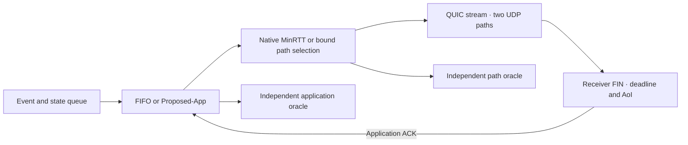
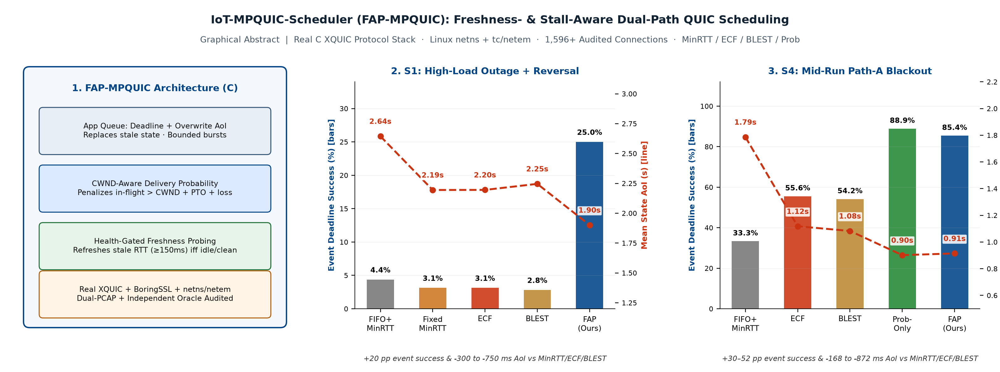
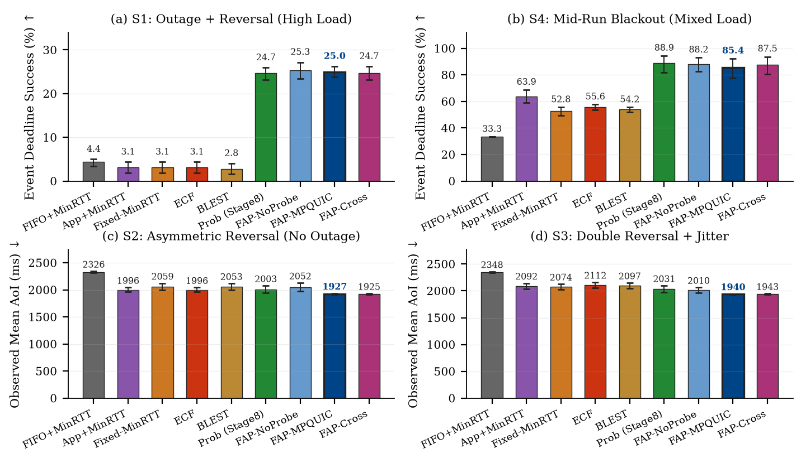
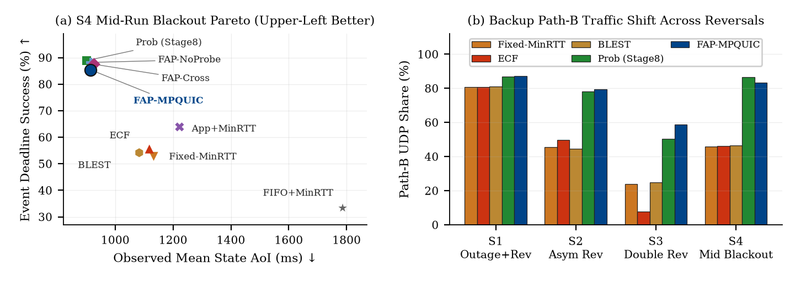
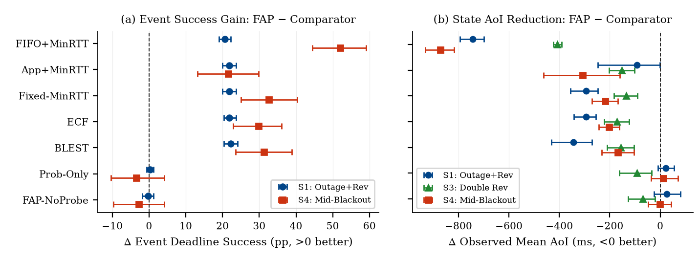
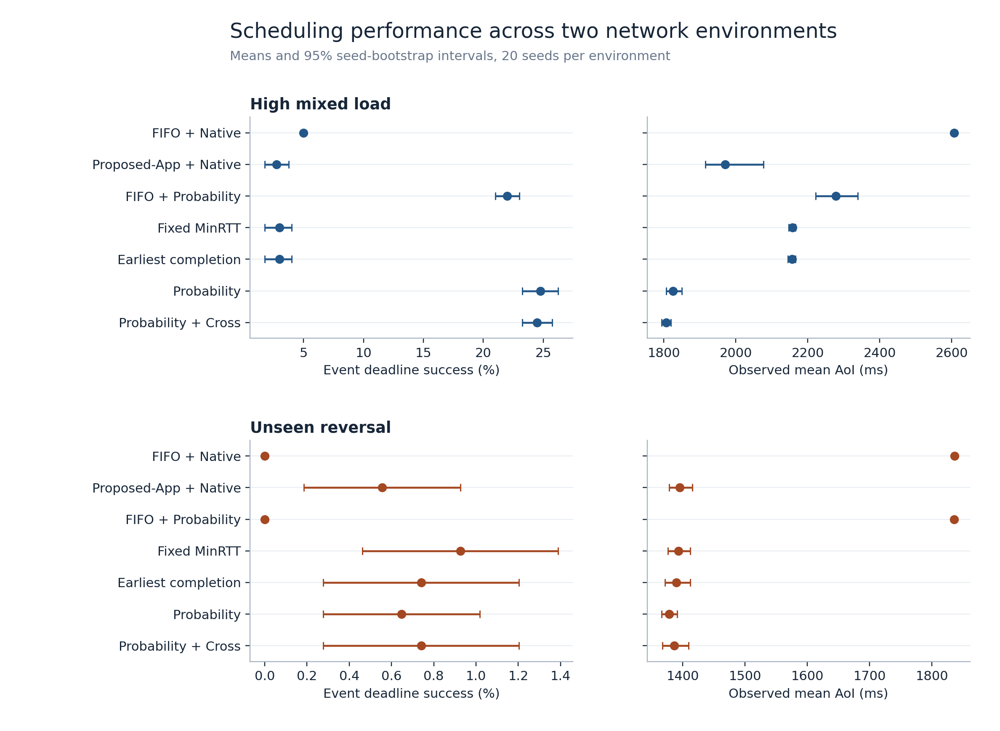

# IoT-MPQUIC-Scheduler

**English** | [简体中文](README.zh-CN.md)

**Deadline- and freshness-aware multipath QUIC scheduling for IoT traffic.**

IoT-MPQUIC-Scheduler sends periodic sensor updates and independent events over one QUIC connection with two real UDP paths. It measures whether joint record scheduling and path selection can improve event deadline delivery while keeping sensor data fresh as link conditions change.

[Results](#results) · [Quick start](#quick-start) · [Reproduce](#reproduce-the-experiments) · [IEEE Manuscript (PDF)](papers/iot-mpquic-scheduler/manuscript.pdf) · [Stage 10 Report](docs/stage10-fap-mpquic-report.md)

## How it works



Proposed-App uses receiver ACKs, deadline budget, event severity and state freshness. It replaces older pending state. Custom path policies bind each stream to an initial path. Strict mode repairs on that path, while cross-path mode can repair over the alternate. Separate oracles replay the application choices and initial path choices.

## Results

### Stage 10 · Freshness- and Stall-Aware `FAP-MPQUIC` (576 Real XQUIC Connections)

Stage 10 introduces **`FAP-MPQUIC`** (`fresh-aware`)—combining CWND-blocking-aware deadline probability estimation with health-gated stale-path freshness probing—and evaluates **9 policies** (including classical **`BLEST`**, **`ECF`**, **`Fixed-MinRTT`**, **`MinRTT`**, Stage 8 **`Prob`**, and a **`FAP-NoProbe`** ablation) across **4 dynamic dual-path regimes × 16 held-out seeds = 576 real `XQUIC` connections** (`all_client_ok = True`), analyzed with 5,000-resample seed-bootstrap 95% CIs, 20,000-draw paired sign-flip permutation tests, and global Holm-Bonferroni correction.



| Scenario (16 seeds × 9 policies) | `FIFO+MinRTT` | `App+MinRTT` | `Fixed-MinRTT` | `ECF` | `BLEST` | `Prob (Stg. 8)` | `FAP-NoProbe` | **`FAP-MPQUIC` (Strict)** |
| --- | :---: | :---: | :---: | :---: | :---: | :---: | :---: | :---: |
| **S1** Outage + Reversal — EvSucc (%) / AoI (ms) | 4.4 / 2,644 | 3.1 / 1,993 | 3.1 / 2,194 | 3.1 / 2,195 | 2.8 / 2,246 | 24.7 / 1,878 | 25.3 / 1,875 | **25.0 / 1,901** |
| **S2** Asymmetric Reversal — AoI (ms) / Goodput (kbps) | 2,326 / 109.8 | 1,996 / 111.0 | 2,059 / 104.5 | 1,996 / 112.9 | 2,053 / 102.5 | 2,003 / 113.6 | 2,052 / 106.8 | **1,927 / 117.3** |
| **S3** Double Reversal + Jitter — AoI (ms) / Path-B (%) | 2,348 / 32.8% | 2,092 / 30.9% | 2,074 / 24.0% | 2,112 / 7.9% | 2,097 / 25.0% | 2,031 / 50.4% | 2,010 / 49.2% | **1,940 / 58.9%** |
| **S4** Mid-Run Blackout — EvSucc (%) / AoI (ms) / Goodput (kbps) | 33.3 / 1,786 / 78.6 | 63.9 / 1,222 / 70.1 | 52.8 / 1,133 / 70.3 | 55.6 / 1,118 / 71.0 | 54.2 / 1,083 / 71.0 | 88.9 / 902 / 81.6 | 88.2 / 915 / 80.0 | **85.4 / 915 / 79.8** |

- **High-load Outage + Reversal (S1):** `FAP-MPQUIC` delivers **+20.62 to +22.19 pp** higher Event Deadline Success than all five classical baselines ($p_{\text{Holm}} \le 0.0025$, Cohen's $d_z = 5.43\text{–}6.66$) while cutting mean AoI by **293.9–743.6 ms** vs `Fixed-MinRTT`, `ECF`, `BLEST`, and `FIFO+MinRTT` ($p_{\text{Holm}} \le 0.0031$).
- **Pure Reversal & Double Reversal (S2 & S3):** `FAP-MPQUIC` achieves the **lowest mean AoI of all 9 policies** (**1,927.0 ms** in S2; **1,939.6 ms** in S3), beating all five classical baselines after Holm correction ($p_{\text{Holm}} \le 0.0034$) and significantly outperforming its own no-probe ablation `FAP-NoProbe` in S3 (**−70.1 ms AoI**, $p_{\text{Holm}} = 0.0123$).
- **Mid-Run Blackout (S4):** `FAP-MPQUIC` **strictly Pareto-dominates all four classical path schedulers (`App+MinRTT`, `Fixed-MinRTT`, `ECF`, `BLEST`) simultaneously across Event Success (+21.5–32.6 pp, $p_{\text{Holm}} \le 0.023$), AoI (−168.2 to −307.7 ms, $p_{\text{Holm}} \le 0.0063$), and Goodput (+8.9–9.8 kbps, $p_{\text{Holm}} \le 0.0072$)**, while remaining statistically tied with Stage 8 `Prob` ($p_{\text{Holm}} = 1.0$) because health-gating suppresses wasted probes on blacked-out paths.







[IEEEtran Manuscript (PDF)](papers/iot-mpquic-scheduler/manuscript.pdf) · [Paper Build Guide](papers/iot-mpquic-scheduler/README.md) · [Stage 10 Technical Report (ZH)](docs/stage10-fap-mpquic-report.md) · [Summary CSV](results/stage10/summary.csv) · [Paired Effects CSV](results/stage10/paired_effects.csv) · [Repair & Ablation Figure](results/stage10/figures/fig05_repair_and_calibration.png)

### Stage 9 · Experimental infrastructure and data audit

Stage 9.3-A audited **288 XQUIC connections** across four development environments. It verified **6,072 labeled submissions**, including **1,688** with a positive remaining budget of at most 100 ms. Of 503 short-budget failures, 496 occurred with 25 ms or less remaining. The data support offline model development with Slack and SRTT as the starting features. Evidence around link transitions and at longer budgets remains sparse. The 48 sealed configurations remain closed with zero runs. [Research plan](docs/stage9-research-plan.md) · [Data and feature audit](docs/stage93a-data-quality-feature-analysis.md) · [Machine-readable results](results/stage93a/)

| Stage | Outcome |
| --- | --- |
| 9.1 | Validated the trace chain from scheduling decisions through actual XQUIC transmission and application delivery. [Acceptance report](docs/stage91-integrity-acceptance.md) |
| 9.2 and 9.2R | Engineering acceptance remained NO-GO on switch timing, tracing overhead and short-budget coverage. [Feasibility report](docs/stage92-feasibility-report.md) · [Reliability report](docs/stage92r-reliability-report.md) |
| 9.2R2 | Passed the engineering gates for 5 ms switch timing, ±5% Goodput equivalence and per-environment sample coverage. [Closure report](docs/stage92r2-targeted-closure-report.md) |

### Stage 8 · Independent validation and generalization

Stage 8 ran **400 formal connections** with 20 new seeds for paired comparisons and 20 separate seeds for randomized path exploration.

- High-load event deadline success was **5.00%** for FIFO + Native, **2.75%** for Proposed-App + Native, **3.00%** each for Fixed MinRTT and Earliest Completion, and **24.75%** for Proposed Probability. The advantage did not recur in the unseen reversal scenario.
- The high-load application–path interaction was **+5.00 percentage points** with Holm-adjusted `p = 0.0512`, just above the prespecified 0.05 threshold.
- Cross-path repair cut mean outage-probe completion from **1,544 ms to 253 ms**. Both means exceeded the **25 ms** deadline.
- The uncalibrated probability model did not consistently beat Slack-only. The offline calibrated model had insufficient statistical evidence of improvement.



[Research report](docs/stage8-research-report.md) · [Final review](docs/stage8-final-review.md) · [Run metrics](results/stage8/runs.csv) · [Calibration figure](results/stage8/figures/03-reliability.png) · [Experiment audit](results/stage8/audit.json)

### Historical experiments

- **Stage 7** separated application and path scheduling across 600 formal runs, with 20 seeds for the high-load factorial. [Research report](docs/stage7-research-report.md) · [Archive audit](results/stage7/audit.json)
- **Stage 6 and earlier** archived 42 dynamic network and mechanism runs with captures from both interfaces and earlier technical reports. [Stage 6 report](docs/stage6-research-report.md) · [Stage 5 report](docs/stage5-report.md) · [Documentation](docs/)

## Quick start

Use Linux with network namespaces, veth and `sch_netem`. The archived runs used Ubuntu 24.04 on WSL2.

```bash
sudo apt-get install -y build-essential git cmake ninja-build iproute2 iputils-ping tcpdump openssl python3
git submodule update --init
bash scripts/build.sh
bash scripts/test.sh
sudo python3 experiments/run_stage8.py results/runs/stage8-pilot --suite pilot --jobs 5
```

The pilot runs 20 independent connections and checks scheduling decisions, endpoint traces and captures from both paths. [Environment setup](docs/experiment-environment.md)

## Reproduce the experiments

### Stage 10 formal real-XQUIC benchmark & IEEE paper

Run the full 576-connection Stage 10 matrix (16 held-out seeds `10101–10116` × 4 scenarios × 9 policies) on Linux with `ip netns` and `tc/netem`, regenerate all four print-ready vector figures, and compile the 8-page IEEEtran manuscript:

```bash
bash scripts/build.sh
bash scripts/test.sh
sudo python3 experiments/run_stage10_fap.py results/stage10 --jobs 6
python3 papers/iot-mpquic-scheduler/build_figures.py
cd papers/iot-mpquic-scheduler && tectonic manuscript.tex
```

### Stage 9 archive replay

Use Python 3.12 or later to regenerate the four Stage 9.3-A outputs from the archived development runs. The reports above describe replay for the earlier Stage 9 suites.

```bash
bash scripts/test.sh --evidence results/stage91/final
python3 -B tests/stage92r_test.py
python3 -B tests/stage92r2_test.py
python3 -B tests/stage93a_test.py
python3 -B evaluation/stage93a.py results/runs/stage93a-recomputed
diff -rq results/stage93a results/runs/stage93a-recomputed
```

### Stage 8 experiments

Build from a clean code checkout to run the full paired and exploration matrices. Install the dependencies in `evaluation/stage6-requirements.txt` to render figures.

```bash
sudo python3 experiments/run_stage8.py results/runs/stage8-paired --suite paired --jobs 8
sudo python3 experiments/run_stage8.py results/runs/stage8-explore --suite explore --jobs 8
python3 evaluation/verify_stage8.py results/stage8 --archive
python3 evaluation/stage8.py results/stage8/raw --out results/runs/stage8-recomputed \
  --figures --compare results/stage8
```

[Experiment configuration](configs/stage8.json) · [Experimental plan](docs/stage8-experiment-plan.md) · [Reproduction details](docs/stage8-research-report.md#17-reproducibility-instructions--复现)

## Repository layout

| Directory | Contents |
| --- | --- |
| `src/` | Gateway queue, scheduling policies, XQUIC endpoints and workload generator |
| `network/` | Dual-veth topology and timed link changes |
| `experiments/`, `evaluation/` | Matrix runner, offline verification and figure generation |
| `patches/xquic/` | STREAM PTO scheduling, integrity tracing and measurement patches applied to the build copy |
| `results/`, `docs/` | Raw evidence, derived tables, figures and technical documentation |
| `papers/` | Standalone IEEEtran manuscript (`manuscript.tex`/`.pdf`), 29 BibTeX references, vector figure script and graphical abstract |

## Scope

The two paths are emulated links on one host and the traffic is generated for replay. Event latency percentiles are conditional on completion inside the measurement window. Probability calibration uses observed outcomes on randomized paths and remains offline. Both endpoints use the pinned XQUIC `XQC_MULTIPATH_10` implementation. [XQUIC version](docs/xquic-api.md) · [Scheduling rules](docs/stage7-algorithm-spec.md)

## License

Project code and documentation use the [MIT License](LICENSE). XQUIC and BoringSSL retain their upstream licenses.

## Part of the 4-Layer AIoT Research Stack

`IoT-MPQUIC-Scheduler` belongs to **L3 · Freshness & Lossy Links** of a reproducible AIoT systems stack:

- **L1 · Reliable Sensing:** [SensorTrust](https://github.com/Sver0411/SensorTrust) (C11 zero-allocation sensor health monitoring)
- **L2 · Adaptive Observation:** [AdaptiveSense](https://github.com/Sver0411/AdaptiveSense) · [TAIS](https://github.com/Sver0411/TAIS) (closed-loop trust-aware scheduling & boundary analysis)
- **L3 · Freshness & Lossy Links:** [EventGuard-LoRa](https://github.com/Sver0411/EventGuard-LoRa) · [NetAdapt-IoT](https://github.com/Sver0411/NetAdapt-IoT) · [IoT-MPQUIC-Scheduler](https://github.com/Sver0411/IoT-MPQUIC-Scheduler)
- **L4 · Resilience & CPS Validation:** [EdgeFaultLab](https://github.com/Sver0411/EdgeFaultLab) · [TinyEdgeBench](https://github.com/Sver0411/TinyEdgeBench) · [Smart-Agriculture-Edge-AI](https://github.com/Sver0411/Smart-Agriculture-Edge-AI) · [AgriTwin-CPS](https://github.com/Sver0411/AgriTwin-CPS)
