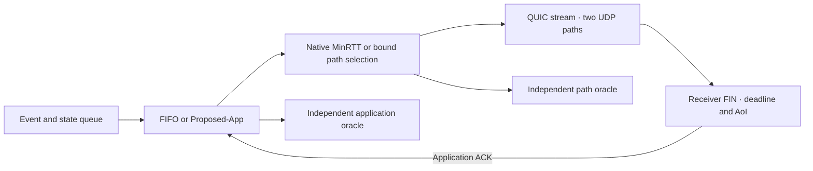
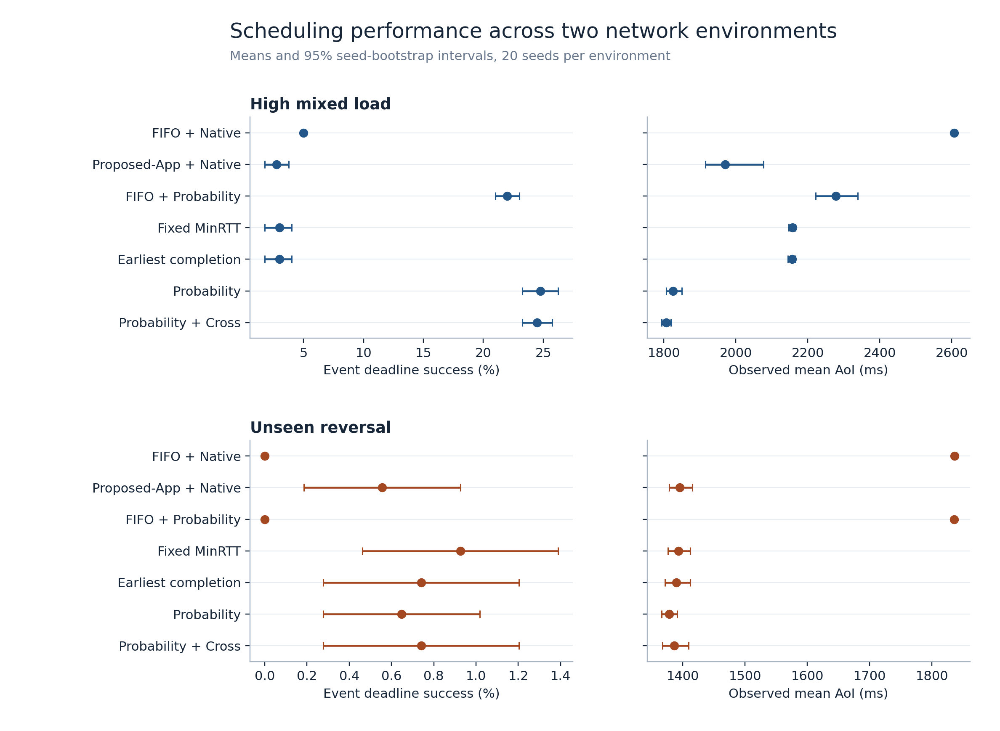

# IoT-MPQUIC-Scheduler

**English** | [简体中文](README.zh-CN.md)

**Deadline- and freshness-aware multipath QUIC scheduling for IoT traffic.**

IoT-MPQUIC-Scheduler sends periodic sensor updates and independent events over one QUIC connection with two real UDP paths. It measures whether joint record scheduling and path selection can improve event deadline delivery while keeping sensor data fresh as link conditions change.

[Results](#results) · [Quick start](#quick-start) · [Reproduce](#reproduce-the-experiments) · [Technical report](docs/stage8-research-report.md)

## How it works



Proposed-App uses receiver ACKs, deadline budget, event severity and state freshness. It replaces older pending state. Custom path policies bind each stream to an initial path. Strict mode repairs on that path, while cross-path mode can repair over the alternate. Separate oracles replay the application choices and initial path choices.

## Results

### Stage 8 · Independent validation and generalization

Stage 8 ran **400 formal connections** with 20 new seeds for paired comparisons and 20 separate seeds for randomized path exploration.

- Under high load, probability-based selection improved event deadline success from **3.00% to 24.75%** against both strict-affinity baselines. It showed no clear advantage in the unseen reversal scenario.
- The high-load application–path interaction was **+5.00 percentage points** for event deadline success, with Holm-adjusted `p = 0.0512`.
- Cross-path repair cut mean outage-probe completion from **1,544 ms to 253 ms**. The uncalibrated probability model did not consistently beat slack-only on held-out records.



[Research report](docs/stage8-research-report.md) · [Run metrics](results/stage8/runs.csv) · [Calibration figure](results/stage8/figures/03-reliability.png) · [Experiment audit](results/stage8/audit.json)

### Historical experiments

- **Stage 7** separated application and path scheduling across 600 formal runs, with 20 seeds for the high-load factorial. [Research report](docs/stage7-research-report.md) · [Archive audit](results/stage7/audit.json)
- **Stage 6 and earlier** archived 42 dynamic network and mechanism runs with captures from both interfaces and earlier technical reports. [Stage 6 report](docs/stage6-research-report.md) · [Stage 5 report](docs/stage5-report.md) · [Documentation](docs/)

## Quick start

Use Linux with network namespaces, veth and `sch_netem`. The archived runs used Ubuntu 24.04 on WSL2.

```bash
sudo apt-get install -y build-essential git cmake ninja-build iproute2 iputils-ping tcpdump openssl python3
git submodule update --init
bash scripts/build.sh
bash scripts/test.sh
sudo python3 experiments/run_stage8.py results/runs/stage8-pilot --suite pilot --jobs 5
```

The pilot runs 20 independent connections and checks scheduling decisions, endpoint traces and captures from both paths. [Environment setup](docs/experiment-environment.md)

## Reproduce the experiments

Build from a clean code checkout to run the full paired and exploration matrices. Install the dependencies in `evaluation/stage6-requirements.txt` to render figures.

```bash
sudo python3 experiments/run_stage8.py results/runs/stage8-paired --suite paired --jobs 8
sudo python3 experiments/run_stage8.py results/runs/stage8-explore --suite explore --jobs 8
python3 evaluation/verify_stage8.py results/stage8 --archive
python3 evaluation/stage8.py results/stage8/raw --out results/runs/stage8-recomputed \
  --figures --compare results/stage8
```

[Experiment configuration](configs/stage8.json) · [Experimental plan](docs/stage8-experiment-plan.md) · [Reproduction details](docs/stage8-research-report.md#17-reproducibility-instructions--复现)

## Repository layout

| Directory | Contents |
| --- | --- |
| `src/` | Gateway queue, scheduling policies, XQUIC endpoints and workload generator |
| `network/` | Dual-veth topology and timed link changes |
| `experiments/`, `evaluation/` | Matrix runner, offline verification and figure generation |
| `patches/xquic/` | Opt-in STREAM PTO scheduling patch, applied to the build copy |
| `results/`, `docs/` | Raw evidence, derived tables, figures and technical documentation |

## Scope

The two paths are emulated links on one host and the traffic is generated for replay. Event latency percentiles are conditional on completion inside the measurement window. Probability calibration uses observed outcomes on randomized paths and remains offline. Both endpoints use the pinned XQUIC `XQC_MULTIPATH_10` implementation. [XQUIC version](docs/xquic-api.md) · [Scheduling rules](docs/stage7-algorithm-spec.md)

## License

Project code and documentation use the [MIT License](LICENSE). XQUIC and BoringSSL retain their upstream licenses.
