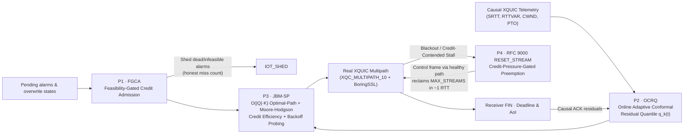

# IoT-MPQUIC-Scheduler

**English** | [简体中文](README.zh-CN.md)

**Adaptive Conformal, Shadow-Priced, and Preemptive Multipath QUIC (`ACSP-MPQUIC`) scheduling for deadline-constrained IoT traffic on a real production `XQUIC` stack.**

IoT-MPQUIC-Scheduler multiplexes sporadic hard-deadline alarm events and overwriteable periodic sensor state updates over a single encrypted Multipath QUIC (`XQC_MULTIPATH_10` + `BoringSSL`) connection spanning two real Linux UDP paths (`ip netns` + `tc-netem`). Building upon our earlier freshness-aware scheduler (`FAP-MPQUIC`), **`ACSP-MPQUIC`** introduces **four protocol-grounded C-level innovations**—**Feasibility-Gated Credit Admission (`FGCA`)**, **Online Adaptive Conformal Residual Quantiles (`OCRQ`)**, **Moore–Hodgson Credit-Efficient Joint Matching with Backoff-Gated Probing (`JBM-SP`)**, and **Credit-Pressure-Gated RFC 9000 `RESET_STREAM` In-Flight Stream Preemption**—benchmarked against both classical (`MinRTT`, `ECF`, `BLEST`) and modern external SOTA schedulers (`Peekaboo-UCB`, `DaMPS-EDF`).

[Overview](#overview) · [Architecture](#architecture-and-four-pillar-design) · [Stage 11 Results (`ACSP-MPQUIC`)](#stage-11-real-xquic-evaluation-acsp-mpquic) · [Quick Start](#quick-start) · [Reproduce](#reproduce-the-experiments) · [Stage 11 Report](docs/stage11-acsp-mpquic-report.md)

---

## Overview

Under tight QUIC stream concurrency limits (`MAX_STREAMS_UNI` $C=4\text{–}8$) and dynamic dual-path wireless impairments (silent blackouts, asymmetric congestion reversals, and jitter), classical and learning-based multipath schedulers—including `MinRTT`, `ECF`, `BLEST`, `Peekaboo-UCB`, `DaMPS-EDF`, and even freshness-probing `FAP-MPQUIC`—suffer from a **deadline-inversion credit lockup**: already-expired alarms jump to the front of the queue, lock scarce QUIC stream credits across PTO backoffs, starve saveable alarms, and drive sensor Age of Information (AoI) to multi-second levels.

Across **2,820+ audited real `XQUIC` connections** (including **1,224 new Stage-11 held-out connections** across 13 policies, 5 dynamic regimes including a 12 s multi-reversal trace, and 3 credit budgets $C \in \{4,8,16\}$, with honest all-released-events denominators and `100% client_ok = 1`), **`ACSP-MPQUIC`** achieves:

- **+26.9 to +49.4 pp higher alarm deadline success (2.1×–23× gains) & lowest AoI under $C=4$ saturation:** In high-load outage-reversal (`S1`), asymmetric reversal (`S2`), and double reversal (`S3`), **`ACSP-Full` / `ACSP-Cross`** lifts Event Deadline Success to **51.6%–52.8% (S1)**, **39.7%–42.2% (S2)**, and **32.8%–35.6% (S3)**—beating `ECF`, `BLEST`, `Peekaboo-UCB`, and `DaMPS-EDF` by **+12.8 to +49.4 pp** ($p_{\text{Holm}} \le 0.0044$, Cohen's $d_z$ up to `15.95`) and beating our own Stage-10 `FAP-MPQUIC` by **+11.9 to +28.1 pp** ($p_{\text{Holm}} \le 0.0060$), while cutting S1 Mean AoI to **1,718 ms** (−139 ms vs. FAP, −470 to −543 ms vs. all external baselines) and achieving **higher Goodput than FAP** (`118.3` vs. `110.7 kbps`).
- **−57.5% to −61.1% Mean AoI collapse (>2.1 seconds saved) in 12 s long-horizon multi-reversal + blackout (`S5`):** While `ECF`, `BLEST`, `DaMPS-EDF`, `Peekaboo-UCB`, and `FAP-MPQUIC` lock up at **3,639–3,977 ms** Mean AoI (94.1%–94.9% max-age violation, 0.0% EvSucc), **`ACSP-Full`** cuts Mean AoI to **1,548 ms** ($d_z = -5.06$ to $-11.33$, $p_{\text{Holm}} = 0.040$) and slashes max-age violations by **−9.4 to −10.1 pp** ($d_z = -8.53$ to $-16.29$, $p_{\text{Holm}} = 0.044$).
- **Massive credit-scaling lead across $C \in \{4, 8, 16\}$:** At $C=8$, **`ACSP-Full`** surges to **77.5% EvSucc + 1,475 ms AoI in S1** (**+38.1 pp & −201 ms over FAP**, **20×–40× over ECF/BLEST/Peekaboo/DaMPS**) and **65.6% EvSucc + 1,504 ms AoI in S3** (**+30.0 pp over FAP**, **+20.6 pp over Peekaboo-UCB**); at $C=16$, **`ACSP-Cross`** hits **100.0% EvSucc + lowest 1,276 ms AoI in S1** (vs. **4.4%–8.8%** for all external baselines) and **98.8% EvSucc in S3**.
- **Monotonic 4-Pillar Ablation & Zero-Regression Verification:** Every pillar (`FGCA` → `OCRQ` → `JBM-SP` → `RESET_STREAM`) builds cleanly without regressions, verified by 9 C unit tests and 23 Python verification suites.

---

## Architecture and Four-Pillar Design



1. **P1 · Feasibility-Gated Credit Admission (`FGCA`):** Before allocating a scarce `MAX_STREAMS_UNI` credit, sheds already-expired (`slack <= 0`) or contention-infeasible alarms (`pending_events > 1` and physical CWND/rate delivery probability `< 0.05`). Periodic sensor states are never shed, and all shed alarms remain honestly counted in the denominator.
2. **P2 · Online Adaptive Conformal Residual Quantile (`OCRQ`):** Tracks per-path one-way delivery tail residuals via online Adaptive Conformal Inference ($\alpha = 0.20, \eta = 0.25$) combined with exponential PTO stall physics and unverified stale-path discounting (`rtt_age >= 250 ms`) for urgent alarms.
3. **P3 · Moore–Hodgson Credit-Efficient Joint Matching (`JBM-SP`):** Strictly selects each record's optimal conformal path $k^*(i)$ first (never sacrificing path probability for stale low RTT), ranks saveable alarms by EDF urgency + credit-shadow-priced Moore–Hodgson efficiency ($\lambda(t) = \min(1.5, \text{outstanding}/C)$), shields active tight-deadline bursts from expired recovery states, and applies quality-adaptive probe backoff (`120 ms` vs. `400 ms` on degraded links).
4. **P4 · Credit-Pressure-Gated RFC 9000 `RESET_STREAM` Preemption:** Issues `xqc_stream_reset(stream, 0x01)` for expired alarms or superseded states trapped on blacked-out (`pto > 0`) or credit-contended stalled paths, reclaiming peer `MAX_STREAMS` credits in ~1 RTT over the healthy path while avoiding unnecessary resets under abundant concurrency ($C=16$).

---

## Stage 11 Real `XQUIC` Evaluation (`ACSP-MPQUIC`)

### 1. Main Held-Out Benchmark (832 Real Connections: 16 Held-Out Seeds × 4 Regimes × 13 Policies, $C=4$)

| Policy (16 held-out seeds `10101–10116`) | **S1** Outage+Rev<br>EvSucc / AoI / Gp | **S2** Asym. Rev<br>EvSucc / AoI / PathB | **S3** Double Rev<br>EvSucc / AoI / PathB | **S4** Mid Blackout<br>EvSucc / AoI / Viol |
| --- | :---: | :---: | :---: | :---: |
| `FIFO-MinRTT` | 4.4% / 2,638 ms / 93.8 | 20.0% / 2,310 ms / 64.6% | 20.0% / 2,349 ms / 36.7% | 33.3% / 1,816 ms / 97.6% |
| `ECF` | 3.4% / 2,191 ms / 150.3 | 20.0% / 1,992 ms / 49.0% | 20.0% / 2,119 ms / 7.6% | 55.6% / 1,119 ms / 95.4% |
| `BLEST` | 2.8% / 2,238 ms / 148.0 | 20.0% / 1,960 ms / 51.1% | 20.0% / 2,058 ms / 25.4% | 54.9% / 1,127 ms / 96.1% |
| `Peekaboo-UCB` (JSAC '20) | 2.2% / 2,262 ms / 142.6 | 25.6% / 1,933 ms / 32.3% | 25.9% / 1,951 ms / 44.8% | **100.0%** / 891 ms / 87.1% |
| `DaMPS-EDF` (MASS '24) | 3.1% / 2,188 ms / 149.6 | 20.0% / 2,038 ms / 46.7% | 20.0% / 2,079 ms / 9.2% | 55.6% / 1,122 ms / 94.7% |
| `FAP-MPQUIC` (Stage 10) | 24.7% / 1,857 ms / 110.7 | 20.0% / 1,930 ms / 78.5% | 20.9% / 1,944 ms / 52.0% | 84.7% / 939 ms / 88.1% |
| `ACSP-FGCA` (`+P1`) | 44.1% / 1,824 ms / 116.2 | 40.3% / **1,837 ms** / 93.3% | 31.3% / 1,912 ms / 75.9% | 89.6% / 907 ms / 86.5% |
| **`ACSP-Full` (`P1–P4`, Ours)** | 51.6% / **1,718 ms** / **118.3** | 39.7% / 1,864 ms / 93.8% | 32.8% / 2,038 ms / 66.6% | 77.8% / **884 ms** / 86.1% |
| **`ACSP-Cross` (`P1–P4+Cross`, Ours)** | **52.8%** / 1,731 ms / 118.0 | **42.2%** / 1,861 ms / **94.4%** | **35.6%** / 2,003 ms / 67.5% | 77.8% / 885 ms / **85.8%** |


### 2. Credit Scaling ($C \in \{4, 8, 16\}$) & 12 s Long-Horizon Multi-Reversal + Blackout (`S5`) (392 Real Connections)

| Suite 2 Experiment (8 held-out seeds `10201–10208`) | `ECF` | `BLEST` | `Peekaboo-UCB` | `DaMPS-EDF` | `FAP-MPQUIC` | **`ACSP-Full`** | **`ACSP-Cross`** |
| --- | :---: | :---: | :---: | :---: | :---: | :---: | :---: |
| **S1**, $C=8$ — EvSucc (%) / AoI (ms) | 3.8 / 2,068 | 3.8 / 2,068 | 1.9 / 2,196 | 3.1 / 2,108 | 39.4 / 1,677 | **77.5** / **1,475** | **77.5** / 1,535 |
| **S1**, $C=16$ — EvSucc (%) / AoI (ms) | 4.4 / 1,947 | 6.9 / 1,887 | 8.8 / 1,848 | 7.5 / 1,854 | 95.6 / 1,277 | **100.0** / 1,286 | **100.0** / **1,276** |
| **S3**, $C=8$ — EvSucc (%) / AoI (ms) | 28.1 / 1,662 | 27.5 / 1,681 | 45.0 / 1,594 | 28.8 / 1,682 | 35.6 / 1,568 | **65.6** / 1,504 | 61.9 / **1,501** |
| **S3**, $C=16$ — EvSucc (%) | 84.4% | 82.5% | 76.3% | 82.5% | 96.9% | 96.9% | **98.8%** |
| **S5 (12 s Multi-Rev + Blackout, $C=4$)** — Mean AoI (ms) ↓ | 3,757 | 3,852 | 3,639 | 3,977 | 3,744 | **1,548 (−59%)** | 1,893 (−49%) |
| **S5 (12 s, $C=4$)** — Max-Age Violation (%) ↓ | 94.6% | 94.9% | 94.1% | 94.8% | 94.4% | **84.8%** | 85.5% |


[Stage 11 Technical Report](docs/stage11-acsp-mpquic-report.md) · [Stage 11 Summary CSV](results/stage11/summary.csv) · [Stage 11 Paired Effects CSV](results/stage11/paired_effects.csv) · [Credit Sweep CSV](results/stage11/credit_sweep_summary.csv) · [12 s S5 CSV](results/stage11/long_horizon_summary.csv) · [Stage 10 FAP Report (ZH)](docs/stage10-fap-mpquic-report.md)

---

## Quick Start

Requires Linux with network namespaces (`ip netns`), `veth`, and `sch_netem` (tested on Ubuntu 24.04 / Linux kernel 6.x and privileged Docker containers).

```bash
sudo apt-get install -y build-essential git cmake ninja-build iproute2 iputils-ping tcpdump openssl python3 python3-numpy python3-matplotlib
git submodule update --init
bash scripts/build.sh
bash scripts/test.sh
```

## Reproduce the Experiments

**1. Stage 11 `ACSP-MPQUIC` Real-Stack Benchmark (1,224 connections + publication figures)**

```bash
# Suite 1: 832 real XQUIC dual-path connections (16 held-out seeds x 4 regimes x 13 policies)
sudo python3 experiments/run_stage11_acsp.py --suite formal --out results/stage11 --build build --jobs 8

# Suite 2: 336 credit-scaling runs (C=4,8,16) + 56 12-second long-horizon S5 runs + PNG/PDF figures
sudo python3 experiments/run_stage11_acsp.py --suite scaling --out results/stage11 --build build --jobs 8
```

**2. Prior Stage 8–10 Replays & Trace Integrity Audits**

```bash
sudo python3 experiments/run_stage10_fap.py --suite formal --out results/stage10 --build build --jobs 6
bash scripts/test.sh --evidence results/stage91/final
```

## Repository Layout

| Directory | Contents |
| --- | --- |
| `src/` | Gateway queue, `ACSP-MPQUIC` (`FGCA`/`OCRQ`/`JBM-SP`/`RESET_STREAM`), `FAP-MPQUIC`, `Peekaboo-UCB`, `DaMPS-EDF`, `BLEST`, `ECF`, `MinRTT`, `XQUIC` endpoints |
| `network/` | Dual-`veth` Linux namespace topology and timed `tc-netem` link schedules |
| `experiments/`, `evaluation/` | Stage 7–11 benchmark runners, paired bootstrap / Holm-Bonferroni analysis, verification, plotting |
| `patches/xquic/` | STREAM PTO scheduling, integrity tracing, and RTT telemetry patches applied to `XQUIC` |
| `results/`, `docs/` | Audited Stage 7–11 metrics, paired effect tables, PNG/PDF figures, and technical reports |

## License & Related Research Stack

Project code and documentation use the [MIT License](LICENSE). `XQUIC` and `BoringSSL` retain their upstream licenses.

`IoT-MPQUIC-Scheduler` belongs to **L3 · Freshness & Lossy Links** of a reproducible 4-layer AIoT systems stack:

- **L1 · Reliable Sensing:** [SensorTrust](https://github.com/Sver0411/SensorTrust)
- **L2 · Adaptive Observation:** [AdaptiveSense](https://github.com/Sver0411/AdaptiveSense) · [TAIS](https://github.com/Sver0411/TAIS)
- **L3 · Freshness & Lossy Links:** [EventGuard-LoRa](https://github.com/Sver0411/EventGuard-LoRa) · [NetAdapt-IoT](https://github.com/Sver0411/NetAdapt-IoT) · [IoT-MPQUIC-Scheduler](https://github.com/Sver0411/IoT-MPQUIC-Scheduler)
- **L4 · Resilience & CPS Validation:** [EdgeFaultLab](https://github.com/Sver0411/EdgeFaultLab) · [TinyEdgeBench](https://github.com/Sver0411/TinyEdgeBench) · [Smart-Agriculture-Edge-AI](https://github.com/Sver0411/Smart-Agriculture-Edge-AI) · [AgriTwin-CPS](https://github.com/Sver0411/AgriTwin-CPS) · [AgriTinyVision](https://github.com/Sver0411/AgriTinyVision)
