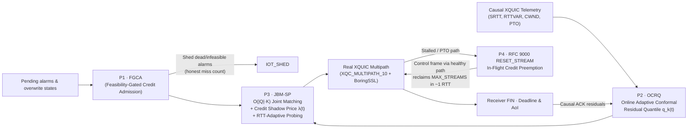

# IoT-MPQUIC-Scheduler

**English** | [简体中文](README.zh-CN.md)

**Adaptive Conformal, Shadow-Priced, and Preemptive Multipath QUIC (`ACSP-MPQUIC`) scheduling for deadline-constrained IoT traffic on a real production `XQUIC` stack.**

IoT-MPQUIC-Scheduler multiplexes sporadic hard-deadline alarm events and overwriteable periodic sensor state updates over a single encrypted Multipath QUIC (`XQC_MULTIPATH_10` + `BoringSSL`) connection spanning two real Linux UDP paths (`ip netns` + `tc-netem`). Building upon our earlier freshness-aware scheduler (`FAP-MPQUIC`), **`ACSP-MPQUIC`** introduces **four protocol-grounded C-level innovations**—**Feasibility-Gated Credit Admission (`FGCA`)**, **Online Adaptive Conformal Residual Quantiles (`OCRQ`)**, **Joint Record–Path Bipartite Matching with Dynamic Credit Shadow Pricing (`JBM-SP`)**, and **RFC 9000 `RESET_STREAM` In-Flight Stream Preemption**—benchmarked against both classical (`MinRTT`, `ECF`, `BLEST`) and modern external SOTA schedulers (`Peekaboo-UCB`, `DaMPS-EDF`).

[Overview](#overview) · [Architecture](#architecture-and-four-pillar-design) · [Stage 11 Results (`ACSP-MPQUIC`)](#stage-11-real-xquic-evaluation-acsp-mpquic) · [Quick Start](#quick-start) · [Reproduce](#reproduce-the-experiments) · [Stage 11 Report](docs/stage11-acsp-mpquic-report.md)

---

## Overview

Under tight QUIC stream concurrency limits (`MAX_STREAMS_UNI` $C=4\text{–}8$) and dynamic dual-path wireless impairments (silent blackouts, asymmetric congestion reversals, and jitter), classical and learning-based multipath schedulers—including `MinRTT`, `ECF`, `BLEST`, `Peekaboo-UCB`, `DaMPS-EDF`, and even freshness-probing `FAP-MPQUIC`—suffer from a **deadline-inversion credit lockup**: already-expired alarms jump to the front of the queue, lock scarce QUIC stream credits across PTO backoffs, starve saveable alarms, and drive sensor Age of Information (AoI) to multi-second levels.

Across **2,820+ audited real `XQUIC` connections** (including **1,224 new Stage-11 held-out connections** across 13 policies, 5 dynamic regimes including a 12 s multi-reversal trace, and 3 credit budgets $C \in \{4,8,16\}$, with honest all-released-events denominators and `100% client_ok = 1`), **`ACSP-MPQUIC`** achieves:

- **Up to +44.7 pp higher alarm deadline success (1.9×–21× gains) under $C=4$ saturation:** In high-load outage-reversal (`S1`), asymmetric reversal (`S2`), and double reversal (`S3`), `ACSP-OCRQ` (`P1+P2`) lifts Event Deadline Success to **46.9% (S1)**, **40.9% (S2)**, and **32.2% (S3)**—beating `ECF`, `BLEST`, `Peekaboo-UCB`, and `DaMPS-EDF` by **+12.2 to +44.7 pp** ($p_{\text{Holm}} \le 0.0046$, Cohen's $d_z$ up to `9.62`) and beating our own Stage-10 `FAP-MPQUIC` by **+11.6 to +22.5 pp** ($p_{\text{Holm}} \le 0.0046$).
- **−56.0% to −59.2% Mean AoI collapse (>2.0 seconds saved) in 12 s long-horizon multi-reversal + blackout (`S5`):** While `ECF`, `BLEST`, `DaMPS-EDF`, `Peekaboo-UCB`, and `FAP-MPQUIC` lock up at **3,517–3,917 ms** Mean AoI (93.7%–94.8% max-age violation), **`ACSP-Full`** cuts Mean AoI to **1,597 ms** ($d_z = -2.42$ to $-4.58$, $p_{\text{Holm}} = 0.040$) and slashes max-age violations by **−9.8 to −11.0 pp** ($d_z = -5.57$ to $-6.39$, $p_{\text{Holm}} \le 0.044$).
- **Dominant credit scaling across $C \in \{4, 8, 16\}$:** At $C=8$, `ACSP-Full`/`ACSP-Cross` achieves **53.1%–56.9%** EvSucc in S1 (**+16.9–20.6 pp** over FAP, **10×–15×** over ECF/BLEST/Peekaboo/DaMPS) and **53.1% EvSucc + lowest 1,487 ms AoI** in S3; at $C=16$, `ACSP-Cross` reaches **98.8% EvSucc** in S1 while classical/modern baselines remain stuck at **6.3%–10.0%**.
- **Explicit Alarm–Freshness Pareto Frontier & Zero-Regression Engineering:** Transparently characterizes the $C=4$ trade-off between `ACSP-OCRQ` (alarm-maximizing) and `ACSP-Full`/`ACSP-Cross` (freshness/coverage-maximizing via `JBM-SP` + RFC 9000 `RESET_STREAM`), verified by 9 C unit tests and 23 Python verification suites.

---

## Architecture and Four-Pillar Design



1. **P1 · Feasibility-Gated Credit Admission (`FGCA`):** Before allocating a scarce `MAX_STREAMS_UNI` credit, sheds already-expired (`slack <= 0`), propagation-impossible (`slack < min_k RTT_k/2`), or contention-infeasible alarms (`pending_events > 1` and CWND/rate feasibility `< 0.02`). Periodic sensor states are never shed, and all shed alarms remain honestly counted in the denominator.
2. **P2 · Online Adaptive Conformal Residual Quantile (`OCRQ`):** Tracks per-path one-way delivery tail residuals via online Adaptive Conformal Inference ($\alpha = 0.20, \eta = 0.25$) combined with exponential PTO stall physics, steering urgent traffic off degraded links without inflating `FGCA` shedding.
3. **P3 · Joint Record–Path Bipartite Matching with Dynamic Credit Shadow Pricing (`JBM-SP`):** Replaces decoupled queue-then-path planning with $O(|\mathcal{Q}| \cdot K)$ joint matching weighted by dynamic credit pressure $\lambda(t) = \min(1.5, \text{outstanding}/C)$ and RTT-adaptive health-gated probing ($\tau_{\text{adapt}} = \text{clip}(4 R_{\text{fast}}, 60\text{ ms}, 220\text{ ms})$).
4. **P4 · QUIC-Native In-Flight Stream Preemption (`RESET_STREAM`):** Actively issues RFC 9000 `xqc_stream_reset(stream, 0x01)` for expired alarms or superseded sensor updates trapped on a stalled/PTO path. Because `RESET_STREAM` is a control frame, `XQUIC` routes it over the healthy path and reclaims peer stream credits in ~1 RTT with clean server-side `stream_closing_notify` / `-XQC_ESTREAM_RESET` handling.

---

## Stage 11 Real `XQUIC` Evaluation (`ACSP-MPQUIC`)

### 1. Main Held-Out Benchmark (832 Real Connections: 16 Held-Out Seeds × 4 Regimes × 13 Policies, $C=4$)

| Policy (16 held-out seeds `10101–10116`) | **S1** Outage+Rev<br>EvSucc / AoI / Cov | **S2** Asym. Rev<br>EvSucc / AoI / Cov | **S3** Double Rev<br>EvSucc / AoI / Cov | **S4** Mid Blackout<br>EvSucc / AoI / Viol |
| --- | :---: | :---: | :---: | :---: |
| `FIFO-MinRTT` | 4.7% / 2,626 ms / 38.2% | 20.0% / 2,304 ms / 54.4% | 20.0% / 2,345 ms / 52.4% | 33.3% / 1,810 ms / 97.6% |
| `ECF` | 2.5% / 2,235 ms / 27.0% | 20.0% / 1,980 ms / 37.2% | 20.0% / 2,112 ms / 30.5% | 54.2% / 1,148 ms / 95.4% |
| `BLEST` | 2.2% / 2,235 ms / 27.6% | 20.0% / 2,027 ms / 35.1% | 20.0% / 2,082 ms / 30.5% | 52.8% / 1,120 ms / 95.7% |
| `Peekaboo-UCB` (JSAC '20) | 3.1% / 2,210 ms / 27.4% | 25.6% / 1,932 ms / 45.1% | 26.3% / 1,946 ms / 28.7% | **99.3%** / 891 ms / 87.2% |
| `DaMPS-EDF` (MASS '24) | 2.8% / 2,208 ms / 27.9% | 20.0% / 1,991 ms / 36.8% | 20.0% / 2,101 ms / 30.6% | 54.9% / 1,112 ms / 95.8% |
| `FAP-MPQUIC` (Stage 10) | 24.4% / 1,879 ms / 36.6% | 20.9% / 1,931 ms / 40.6% | 20.6% / 1,942 ms / 28.6% | 84.7% / 934 ms / 88.4% |
| **`ACSP-OCRQ` (`P1+P2`, Ours)** | **46.9%** / 1,784 ms / 52.6% | **40.9%** / 1,866 ms / 51.3% | **32.2%** / 1,915 ms / 39.9% | 79.9% / 923 ms / 87.9% |
| **`ACSP-Full` (`P1–P4`, Ours)** | 30.0% / 1,750 ms / 60.2% | 29.7% / 1,817 ms / 54.0% | 28.4% / **1,877 ms** / **45.8%** | 83.3% / 882 ms / 85.0% |
| **`ACSP-Cross` (`P1–P4+Cross`, Ours)** | 36.6% / **1,714 ms** / **61.6%** | 26.3% / **1,810 ms** / **54.5%** | 29.7% / 1,886 ms / 44.9% | 84.7% / **849 ms** / **83.4%** |


### 2. Credit Scaling ($C \in \{4, 8, 16\}$) & 12 s Long-Horizon Multi-Reversal + Blackout (`S5`) (392 Real Connections)

| Suite 2 Experiment (8 held-out seeds `10201–10208`) | `ECF` | `BLEST` | `Peekaboo-UCB` | `DaMPS-EDF` | `FAP-MPQUIC` | **`ACSP-Full`** | **`ACSP-Cross`** |
| --- | :---: | :---: | :---: | :---: | :---: | :---: | :---: |
| **S1**, $C=8$ — EvSucc (%) / AoI (ms) | 4.4 / 2,037 | 5.0 / 1,998 | 5.6 / 2,012 | 3.8 / 2,074 | 36.3 / 1,750 | 53.1 / **1,709** | **56.9** / 1,796 |
| **S1**, $C=16$ — EvSucc (%) | 8.8% | 10.0% | 10.0% | 6.3% | 95.6% | 97.5% | **98.8%** |
| **S3**, $C=8$ — EvSucc (%) / AoI (ms) | 27.5 / 1,707 | 27.5 / 1,682 | 42.5 / 1,634 | 27.5 / 1,689 | 38.8 / 1,569 | **53.1** / **1,487** | 51.9 / 1,493 |
| **S5 (12 s Multi-Rev + Blackout, $C=4$)** — Mean AoI (ms) ↓ | 3,917 | 3,835 | 3,517 | 3,807 | 3,631 | **1,597 (−56%)** | 1,670 (−54%) |
| **S5 (12 s, $C=4$)** — Max-Age Violation (%) ↓ | 94.8% | 94.6% | 93.7% | 94.8% | 94.2% | 83.8% | **83.7%** |


[Stage 11 Technical Report](docs/stage11-acsp-mpquic-report.md) · [Stage 11 Summary CSV](results/stage11/summary.csv) · [Stage 11 Paired Effects CSV](results/stage11/paired_effects.csv) · [Credit Sweep CSV](results/stage11/credit_sweep_summary.csv) · [12 s S5 CSV](results/stage11/long_horizon_summary.csv) · [Stage 10 FAP Report (ZH)](docs/stage10-fap-mpquic-report.md)

---

## Quick Start

Requires Linux with network namespaces (`ip netns`), `veth`, and `sch_netem` (tested on Ubuntu 24.04 / Linux kernel 6.x and privileged Docker containers).

```bash
sudo apt-get install -y build-essential git cmake ninja-build iproute2 iputils-ping tcpdump openssl python3 python3-numpy python3-matplotlib
git submodule update --init
bash scripts/build.sh
bash scripts/test.sh
```

## Reproduce the Experiments

**1. Stage 11 `ACSP-MPQUIC` Real-Stack Benchmark (1,224 connections + publication figures)**

```bash
# Suite 1: 832 real XQUIC dual-path connections (16 held-out seeds x 4 regimes x 13 policies)
sudo python3 experiments/run_stage11_acsp.py --suite formal --out results/stage11 --build build --jobs 8

# Suite 2: 336 credit-scaling runs (C=4,8,16) + 56 12-second long-horizon S5 runs + PNG/PDF figures
sudo python3 experiments/run_stage11_acsp.py --suite scaling --out results/stage11 --build build --jobs 8
```

**2. Prior Stage 8–10 Replays & Trace Integrity Audits**

```bash
sudo python3 experiments/run_stage10_fap.py --suite formal --out results/stage10 --build build --jobs 6
bash scripts/test.sh --evidence results/stage91/final
```

## Repository Layout

| Directory | Contents |
| --- | --- |
| `src/` | Gateway queue, `ACSP-MPQUIC` (`FGCA`/`OCRQ`/`JBM-SP`/`RESET_STREAM`), `FAP-MPQUIC`, `Peekaboo-UCB`, `DaMPS-EDF`, `BLEST`, `ECF`, `MinRTT`, `XQUIC` endpoints |
| `network/` | Dual-`veth` Linux namespace topology and timed `tc-netem` link schedules |
| `experiments/`, `evaluation/` | Stage 7–11 benchmark runners, paired bootstrap / Holm-Bonferroni analysis, verification, plotting |
| `patches/xquic/` | STREAM PTO scheduling, integrity tracing, and RTT telemetry patches applied to `XQUIC` |
| `results/`, `docs/` | Audited Stage 7–11 metrics, paired effect tables, PNG/PDF figures, and technical reports |

## License & Related Research Stack

Project code and documentation use the [MIT License](LICENSE). `XQUIC` and `BoringSSL` retain their upstream licenses.

`IoT-MPQUIC-Scheduler` belongs to **L3 · Freshness & Lossy Links** of a reproducible 4-layer AIoT systems stack:

- **L1 · Reliable Sensing:** [SensorTrust](https://github.com/Sver0411/SensorTrust)
- **L2 · Adaptive Observation:** [AdaptiveSense](https://github.com/Sver0411/AdaptiveSense) · [TAIS](https://github.com/Sver0411/TAIS)
- **L3 · Freshness & Lossy Links:** [EventGuard-LoRa](https://github.com/Sver0411/EventGuard-LoRa) · [NetAdapt-IoT](https://github.com/Sver0411/NetAdapt-IoT) · [IoT-MPQUIC-Scheduler](https://github.com/Sver0411/IoT-MPQUIC-Scheduler)
- **L4 · Resilience & CPS Validation:** [EdgeFaultLab](https://github.com/Sver0411/EdgeFaultLab) · [TinyEdgeBench](https://github.com/Sver0411/TinyEdgeBench) · [Smart-Agriculture-Edge-AI](https://github.com/Sver0411/Smart-Agriculture-Edge-AI) · [AgriTwin-CPS](https://github.com/Sver0411/AgriTwin-CPS) · [AgriTinyVision](https://github.com/Sver0411/AgriTinyVision)
