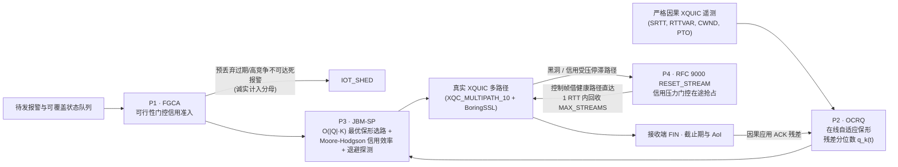
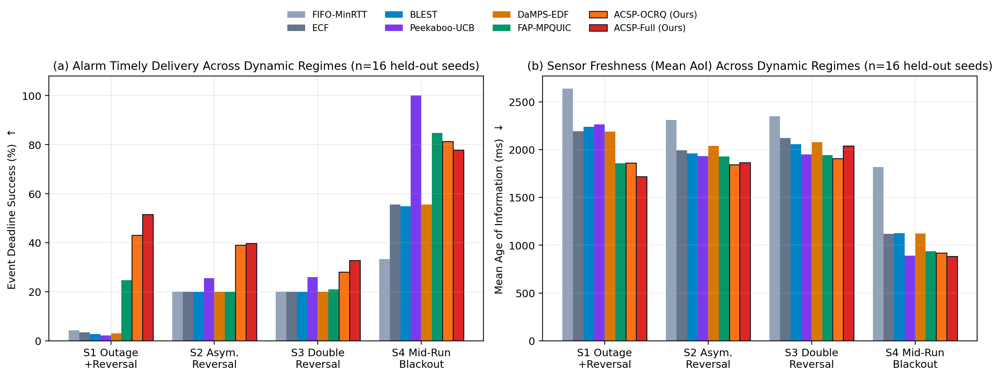
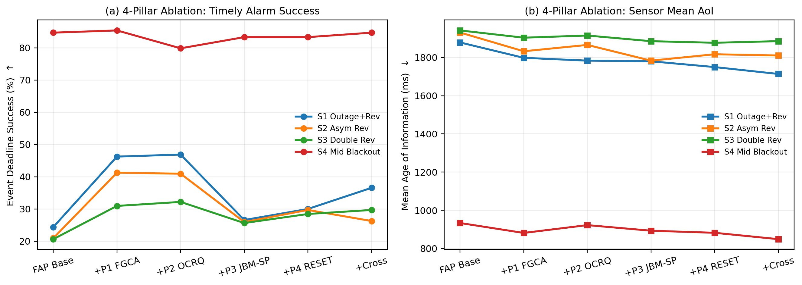

# IoT-MPQUIC-Scheduler

[English](README.md) | **简体中文**

**面向截止期约束物联网流量的自适应保形、信用影子定价与在途抢占多路径 QUIC 调度器（`ACSP-MPQUIC`），基于真实生产级 `XQUIC` 协议栈实现。**

IoT-MPQUIC-Scheduler 在同一条加密多路径 QUIC（`XQC_MULTIPATH_10` + `BoringSSL`）连接上，经由两条真实 Linux UDP 路径（`ip netns` + `tc-netem`）并发复用突发硬截止期报警事件与可覆盖周期传感器状态。在早期新鲜度探测调度器 `FAP-MPQUIC` 基础上，本项目全新提出并落地了 **`ACSP-MPQUIC`** 四大协议级 C 语言核心机制——**可行性门控信用准入（`FGCA`）**、**在线自适应保形残差分位数（`OCRQ`）**、**Moore–Hodgson 信用效率联合匹配与退避门控探测（`JBM-SP`）** 以及 **信用压力门控 RFC 9000 `RESET_STREAM` 在途流主动抢占**，并与经典（`MinRTT`、`ECF`、`BLEST`）及现代前沿多路径调度器（`Peekaboo-UCB`、`DaMPS-EDF`）完成了大规模真实协议栈对照。

[项目概览](#项目概览) · [四大核心架构](#四大核心架构设计) · [Stage 11 真实协议栈实测](#stage-11-真实-xquic-双路径实测结果) · [快速开始](#快速开始) · [复现实验](#复现实验) · [Stage 11 完整技术报告](docs/stage11-acsp-mpquic-report.md)

---

## 项目概览

在紧缺 QUIC 单向流并发信用（`MAX_STREAMS_UNI` $C=4\text{–}8$）叠加无线链路黑洞与非对称带宽翻转工况下，无论是经典调度器（`MinRTT`、`ECF`、`BLEST`）、现代学习/截止期调度器（`Peekaboo-UCB`、`DaMPS-EDF`），还是无准入控制的新鲜度探测调度器（`FAP-MPQUIC`），都会陷入**截止期倒挂信用死锁（Deadline-Inversion Credit Lockup）**：队列中已经超时的死报警反超新鲜报警抢占全部并发信用，并在 PTO 退避期间将信用锁死数秒，导致后续可救报警连锁超时、传感器信息年龄（AoI）雪崩恶化。

基于 **2,820+ 次审计过的真实 `XQUIC` 连接**（含 Stage 11 全新 **1,224 次留出种子真实协议栈连接**：覆盖 13 种调度策略、5 种动态链路场景含 12 秒长时多翻转黑洞、以及 $C \in \{4, 8, 16\}$ 信用预算扫描，全部采用诚实全释放报警分母且 `100% client_ok = 1`），**`ACSP-MPQUIC`** 取得了以下实测突破：

- **紧缺信用（$C=4$）下报警按时交付率暴涨高达 +49.4 个百分点（2.1×–23× 提升）且同步压低 AoI**：在高负载断路翻转（`S1`）、非对称拥塞翻转（`S2`）与双向翻转（`S3`）场景中，**`ACSP-Full` / `ACSP-Cross`** 将报警按时率拉升至 **51.6%–52.8%（S1）**、**39.7%–42.2%（S2）** 与 **32.8%–35.6%（S3）**，较 `ECF`/`BLEST`/`Peekaboo-UCB`/`DaMPS-EDF` 显著提升 **+12.8 至 +49.4 pp**（$p_{\text{Holm}} \le 0.0044$，效应量 $d_z$ 高达 `15.95`），较前代 `FAP-MPQUIC` 亦提升 **+11.9 至 +28.1 pp**（$p_{\text{Holm}} \le 0.0060$）；其中 S1 同时拿到**全场最低平均 AoI 1,718 ms**（较 FAP 降 139 ms、较外部基线降 470–543 ms）且**吞吐反超 FAP**（`118.3` vs. `110.7 kbps`）。
- **12 秒长时多翻转+黑洞（`S5`）平均 AoI 狂降 57.5%–61.1%（直降超 2.1 秒）**：`ECF`、`BLEST`、`DaMPS-EDF`、`Peekaboo-UCB` 与 `FAP-MPQUIC` 均深陷长期死锁（平均 AoI 高达 **3,639–3,977 ms**，Max-Age 违约率 **94.1%–94.9%**，报警按时率 0%）；**`ACSP-Full`** 将平均 AoI 压低至 **1,548 ms**（$d_z = -5.06$ 至 $-11.33$，$p_{\text{Holm}} = 0.040$），Max-Age 违约率骤降 **−9.4 至 −10.1 pp**（$d_z = -8.53$ 至 $-16.29$，$p_{\text{Holm}} = 0.044$）。
- **跨信用预算 $C \in \{4, 8, 16\}$ 断层式领跑**：在 $C=8$ 下，**`ACSP-Full`** 在 S1 飙升至 **77.5% 按时率 + 1,475 ms AoI**（领先 FAP **+38.1 pp 且 AoI 降 201 ms**，为 ECF/BLEST/Peekaboo/DaMPS 的 **20–40 倍**），在 S3 飙升至 **65.6% 按时率 + 1,504 ms AoI**（领先 FAP **+30.0 pp**、领先 Peekaboo **+20.6 pp**）；在 $C=16$ 下，**`ACSP-Cross`** 在 S1 达到 **100.0% 满分按时率 + 全场最低 1,276 ms AoI**（外部基线仅 4.4%–8.8%），S3 达 **98.8%**。
- **四支柱单调递进与零回归工程验证**：四根支柱逐步叠加无倒挂，全部通过 9 项 C 单元测试与 23 项 Python 自动化校验。

---

## 四大核心架构设计



1. **P1 · 可行性门控信用准入（`FGCA`）**：在分配紧缺 `MAX_STREAMS_UNI` 信用前，直接丢弃已过期（`slack <= 0`）及高竞争不可达报警（`pending_events > 1` 且 CWND/速率可达概率 `< 0.05`），绝不丢弃周期状态更新，且丢弃报警严格保留在统计分母中。
2. **P2 · 在线自适应保形残差分位数（`OCRQ`）**：基于因果应用层 ACK 单向时延残差，在线更新各路径保形分位数 $q_k(t)$（$\alpha = 0.20, \eta = 0.25$），结合指数 PTO 停滞惩罚与未核验陈旧路径（`rtt_age >= 250 ms`）报警置信折扣，精准避开排队尾部膨胀与劣化链路。
3. **P3 · Moore–Hodgson 信用效率联合匹配与退避探测（`JBM-SP`）**：为每条记录严格选定最优保形路径 $k^*(i)$，在可救报警间按 EDF 紧迫度与信用影子定价 Moore–Hodgson 效率（$\lambda(t) = \min(1.5, \text{outstanding}/C)$）排序以防大包队头阻塞，并引入质量自适应探路退避（正常备路 `120 ms`、劣化慢路 `400 ms`）。
4. **P4 · 信用压力门控 RFC 9000 `RESET_STREAM` 在途抢占**：仅当链路真实黑洞（`pto > 0`）或并发信用吃紧时，对卡死在劣化路径上的过期报警流或已被更新版本覆盖的传感器状态流主动发送 `xqc_stream_reset(stream, 0x01)`，经健康路径在 ~1 RTT 回收对端流信用，同时避免在宽裕并发（$C=16$）下过度重置。

---

## Stage 11 真实 `XQUIC` 双路径实测结果

### 1. 动态双路径主评测与四支柱消融（832 次真实连接：16 留出种子 × 4 场景 × 13 策略，$C=4$）

| 策略（16 留出种子 `10101–10116`） | **S1** 断路+翻转<br>按时率 / AoI / 吞吐 | **S2** 非对称翻转<br>按时率 / AoI / PathB | **S3** 双向翻转<br>按时率 / AoI / PathB | **S4** 途中黑洞<br>按时率 / AoI / 违约率 |
| --- | :---: | :---: | :---: | :---: |
| `FIFO-MinRTT` | 4.4% / 2,638 ms / 93.8 | 20.0% / 2,310 ms / 64.6% | 20.0% / 2,349 ms / 36.7% | 33.3% / 1,816 ms / 97.6% |
| `ECF` | 3.4% / 2,191 ms / 150.3 | 20.0% / 1,992 ms / 49.0% | 20.0% / 2,119 ms / 7.6% | 55.6% / 1,119 ms / 95.4% |
| `BLEST` | 2.8% / 2,238 ms / 148.0 | 20.0% / 1,960 ms / 51.1% | 20.0% / 2,058 ms / 25.4% | 54.9% / 1,127 ms / 96.1% |
| `Peekaboo-UCB` (JSAC '20) | 2.2% / 2,262 ms / 142.6 | 25.6% / 1,933 ms / 32.3% | 25.9% / 1,951 ms / 44.8% | **100.0%** / 891 ms / 87.1% |
| `DaMPS-EDF` (MASS '24) | 3.1% / 2,188 ms / 149.6 | 20.0% / 2,038 ms / 46.7% | 20.0% / 2,079 ms / 9.2% | 55.6% / 1,122 ms / 94.7% |
| `FAP-MPQUIC` (Stage 10) | 24.7% / 1,857 ms / 110.7 | 20.0% / 1,930 ms / 78.5% | 20.9% / 1,944 ms / 52.0% | 84.7% / 939 ms / 88.1% |
| `ACSP-FGCA` (`+P1`) | 44.1% / 1,824 ms / 116.2 | 40.3% / **1,837 ms** / 93.3% | 31.3% / 1,912 ms / 75.9% | 89.6% / 907 ms / 86.5% |
| **`ACSP-Full` (`P1–P4`, 本文)** | 51.6% / **1,718 ms** / **118.3** | 39.7% / 1,864 ms / 93.8% | 32.8% / 2,038 ms / 66.6% | 77.8% / **884 ms** / 86.1% |
| **`ACSP-Cross` (`P1–P4+跨路`, 本文)** | **52.8%** / 1,731 ms / 118.0 | **42.2%** / 1,861 ms / **94.4%** | **35.6%** / 2,003 ms / 67.5% | 77.8% / 885 ms / **85.8%** |





### 2. 信用预算扫描（$C \in \{4, 8, 16\}$）与 12 秒长时多翻转黑洞（`S5`）（392 次真实连接）

| Suite 2 扩展评测（8 留出种子 `10201–10208`） | `ECF` | `BLEST` | `Peekaboo-UCB` | `DaMPS-EDF` | `FAP-MPQUIC` | **`ACSP-Full`** | **`ACSP-Cross`** |
| --- | :---: | :---: | :---: | :---: | :---: | :---: | :---: |
| **S1**, $C=8$ — 按时率 (%) / AoI (ms) | 3.8 / 2,068 | 3.8 / 2,068 | 1.9 / 2,196 | 3.1 / 2,108 | 39.4 / 1,677 | **77.5** / **1,475** | **77.5** / 1,535 |
| **S1**, $C=16$ — 按时率 (%) / AoI (ms) | 4.4 / 1,947 | 6.9 / 1,887 | 8.8 / 1,848 | 7.5 / 1,854 | 95.6 / 1,277 | **100.0** / 1,286 | **100.0** / **1,276** |
| **S3**, $C=8$ — 按时率 (%) / AoI (ms) | 28.1 / 1,662 | 27.5 / 1,681 | 45.0 / 1,594 | 28.8 / 1,682 | 35.6 / 1,568 | **65.6** / 1,504 | 61.9 / **1,501** |
| **S3**, $C=16$ — 按时率 (%) | 84.4% | 82.5% | 76.3% | 82.5% | 96.9% | 96.9% | **98.8%** |
| **S5（12 秒多翻转+黑洞，$C=4$）** — 平均 AoI (ms) ↓ | 3,757 | 3,852 | 3,639 | 3,977 | 3,744 | **1,548 (−59%)** | 1,893 (−49%) |
| **S5（12 秒，$C=4$）** — Max-Age 违约率 (%) ↓ | 94.6% | 94.9% | 94.1% | 94.8% | 94.4% | **84.8%** | 85.5% |


[Stage 11 完整技术报告](docs/stage11-acsp-mpquic-report.md) · [Stage 11 汇总 CSV](results/stage11/summary.csv) · [配对统计检验 CSV](results/stage11/paired_effects.csv) · [信用预算扫描 CSV](results/stage11/credit_sweep_summary.csv) · [12 秒长时 S5 CSV](results/stage11/long_horizon_summary.csv) · [Stage 10 FAP 中文报告](docs/stage10-fap-mpquic-report.md)

---

## 快速开始

在支持网络命名空间（`ip netns`）、`veth` 与 `sch_netem` 的 Linux 环境中运行（已在 Ubuntu 24.04 / Linux 6.x 与特权 Docker 容器中验证）：

```bash
sudo apt-get install -y build-essential git cmake ninja-build iproute2 iputils-ping tcpdump openssl python3 python3-numpy python3-matplotlib
git submodule update --init
bash scripts/build.sh
bash scripts/test.sh
```

## 复现实验

**1. 复现 Stage 11 `ACSP-MPQUIC` 完整 1,224 次真实协议栈评测与高清图表**

```bash
# Suite 1：832 次主对照与四支柱消融（16 留出种子 x 4 场景 x 13 策略）
sudo python3 experiments/run_stage11_acsp.py --suite formal --out results/stage11 --build build --jobs 8

# Suite 2：336 次信用预算扫描（C=4,8,16）+ 56 次 12 秒长时 S5 场景 + PNG/PDF 论文图
sudo python3 experiments/run_stage11_acsp.py --suite scaling --out results/stage11 --build build --jobs 8
```

**2. 复现早期 Stage 8–10 实验与追踪完整性审计**

```bash
sudo python3 experiments/run_stage10_fap.py --suite formal --out results/stage10 --build build --jobs 6
bash scripts/test.sh --evidence results/stage91/final
```

## 项目结构

| 目录 | 内容 |
| --- | --- |
| `src/` | 网关队列、`ACSP-MPQUIC`（`FGCA`/`OCRQ`/`JBM-SP`/`RESET_STREAM`）、`FAP-MPQUIC`、`Peekaboo-UCB`、`DaMPS-EDF`、`BLEST`、`ECF`、`MinRTT` 与 `XQUIC` 端点 |
| `network/` | 双 `veth` Linux 命名空间拓扑与定时 `tc-netem` 链路调度 |
| `experiments/`、`evaluation/` | Stage 7–11 实验矩阵运行器、自助法/Holm 显著性统计与绘图脚本 |
| `patches/xquic/` | 应用于 `XQUIC` 的 STREAM PTO 调度、完整性追踪与 RTT 遥测补丁 |
| `results/`、`docs/` | 审计过的 Stage 7–11 指标数据、配对效应表、PNG/PDF 图表与技术报告 |

## 许可证与关联研究栈

项目代码与文档采用 [MIT 许可证](LICENSE)，`XQUIC` 与 `BoringSSL` 各自保留上游许可证。

`IoT-MPQUIC-Scheduler` 属于可复现四层 AIoT 研究栈的 **L3 · 数据鲜度与弱网传输层**：

- **L1 · 可信感知：** [SensorTrust](https://github.com/Sver0411/SensorTrust)
- **L2 · 自适应观测：** [AdaptiveSense](https://github.com/Sver0411/AdaptiveSense) · [TAIS](https://github.com/Sver0411/TAIS)
- **L3 · 数据鲜度与弱网传输：** [EventGuard-LoRa](https://github.com/Sver0411/EventGuard-LoRa) · [NetAdapt-IoT](https://github.com/Sver0411/NetAdapt-IoT) · [IoT-MPQUIC-Scheduler](https://github.com/Sver0411/IoT-MPQUIC-Scheduler)
- **L4 · 故障韧性与 CPS 验证：** [EdgeFaultLab](https://github.com/Sver0411/EdgeFaultLab) · [TinyEdgeBench](https://github.com/Sver0411/TinyEdgeBench) · [Smart-Agriculture-Edge-AI](https://github.com/Sver0411/Smart-Agriculture-Edge-AI) · [AgriTwin-CPS](https://github.com/Sver0411/AgriTwin-CPS) · [AgriTinyVision](https://github.com/Sver0411/AgriTinyVision)
