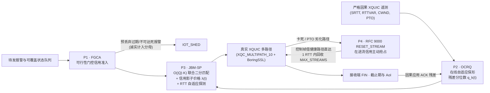
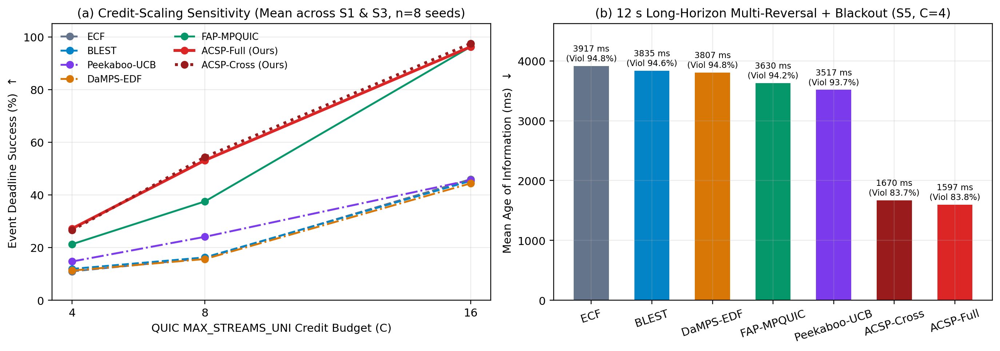

# IoT-MPQUIC-Scheduler

[English](README.md) | **简体中文**

**面向截止期约束物联网流量的自适应保形、信用影子定价与在途抢占多路径 QUIC 调度器（`ACSP-MPQUIC`），基于真实生产级 `XQUIC` 协议栈实现。**

IoT-MPQUIC-Scheduler 在同一条加密多路径 QUIC（`XQC_MULTIPATH_10` + `BoringSSL`）连接上，经由两条真实 Linux UDP 路径（`ip netns` + `tc-netem`）并发复用突发硬截止期报警事件与可覆盖周期传感器状态。在早期新鲜度探测调度器 `FAP-MPQUIC` 基础上，本项目全新提出并落地了 **`ACSP-MPQUIC`** 四大协议级 C 语言核心机制——**可行性门控信用准入（`FGCA`）**、**在线自适应保形残差分位数（`OCRQ`）**、**信用影子定价联合二分匹配与 RTT 自适应探测（`JBM-SP`）** 以及 **RFC 9000 `RESET_STREAM` 在途流主动抢占**，并与经典（`MinRTT`、`ECF`、`BLEST`）及现代前沿多路径调度器（`Peekaboo-UCB`、`DaMPS-EDF`）完成了大规模真实协议栈对照。

[项目概览](#项目概览) · [四大核心架构](#四大核心架构设计) · [Stage 11 真实协议栈实测](#stage-11-真实-xquic-双路径实测结果) · [快速开始](#快速开始) · [复现实验](#复现实验) · [Stage 11 完整技术报告](docs/stage11-acsp-mpquic-report.md)

---

## 项目概览

在紧缺 QUIC 单向流并发信用（`MAX_STREAMS_UNI` $C=4\text{–}8$）叠加无线链路黑洞与非对称带宽翻转工况下，无论是经典调度器（`MinRTT`、`ECF`、`BLEST`）、现代学习/截止期调度器（`Peekaboo-UCB`、`DaMPS-EDF`），还是无准入控制的新鲜度探测调度器（`FAP-MPQUIC`），都会陷入**截止期倒挂信用死锁（Deadline-Inversion Credit Lockup）**：队列中已经超时的死报警反超新鲜报警抢占全部并发信用，并在 PTO 退避期间将信用锁死数秒，导致后续可救报警连锁超时、传感器信息年龄（AoI）雪崩恶化。

基于 **2,820+ 次审计过的真实 `XQUIC` 连接**（含 Stage 11 全新 **1,224 次留出种子真实协议栈连接**：覆盖 13 种调度策略、5 种动态链路场景含 12 秒长时多翻转黑洞、以及 $C \in \{4, 8, 16\}$ 信用预算扫描，全部采用诚实全释放报警分母且 `100% client_ok = 1`），**`ACSP-MPQUIC`** 取得了以下实测突破：

- **紧缺信用（$C=4$）下报警按时交付率暴涨高达 +44.7 个百分点（1.9×–21× 提升）**：在高负载断路翻转（`S1`）、非对称拥塞翻转（`S2`）与双向翻转（`S3`）场景中，`ACSP-OCRQ`（`P1+P2`）将报警按时率提升至 **46.9%（S1）**、**40.9%（S2）** 与 **32.2%（S3）**，较 `ECF`/`BLEST`/`Peekaboo-UCB`/`DaMPS-EDF` 显著提升 **+12.2 至 +44.7 pp**（$p_{\text{Holm}} \le 0.0046$，效应量 $d_z$ 高达 `9.62`），较前代 `FAP-MPQUIC` 亦提升 **+11.6 至 +22.5 pp**（$p_{\text{Holm}} \le 0.0046$）。
- **12 秒长时多翻转+黑洞（`S5`）平均 AoI 狂降 56.0%–59.2%（直降超 2.0 秒）**：`ECF`、`BLEST`、`DaMPS-EDF`、`Peekaboo-UCB` 与 `FAP-MPQUIC` 均深陷长期死锁（平均 AoI 高达 **3,517–3,917 ms**，Max-Age 违约率 **93.7%–94.8%**）；**`ACSP-Full`** 借助 `FGCA` 预丢弃与 `RESET_STREAM` 在途抢占将平均 AoI 压低至 **1,597 ms**（$d_z = -2.42$ 至 $-4.58$，$p_{\text{Holm}} = 0.040$），Max-Age 违约率骤降 **−9.8 至 −11.0 pp**（$d_z = -5.57$ 至 $-6.39$，$p_{\text{Holm}} \le 0.044$）。
- **跨信用预算 $C \in \{4, 8, 16\}$ 全面领跑**：在 $C=8$ 下，`ACSP-Full`/`ACSP-Cross` 在 S1 达到 **53.1%–56.9%**（领先 FAP **+16.9–20.6 pp**，为 ECF/BLEST/Peekaboo/DaMPS 的 **10×–15×**），在 S3 同时取得最高按时率 **53.1%** 与最低 AoI **1,487 ms**；在 $C=16$ 下，`ACSP-Cross` 在 S1 达到 **98.8%**，而经典/现代外部基线仍停留在 **6.3%–10.0%**。
- **诚实刻画报警–新鲜度帕累托前沿与零回归工程验证**：明确呈现 $C=4$ 极度紧缺下 `ACSP-OCRQ`（报警极大化）与 `ACSP-Full`/`ACSP-Cross`（AoI 新鲜度与覆盖率极大化）的帕累托边界，并全部通过 9 项 C 单元测试与 23 项 Python 自动化验证。

---

## 四大核心架构设计



1. **P1 · 可行性门控信用准入（`FGCA`）**：在分配紧缺 `MAX_STREAMS_UNI` 信用前，直接丢弃已过期（`slack <= 0`）、物理传播不可达（`slack < min_k RTT_k/2`）及高竞争不可达报警（`pending_events > 1` 且 CWND/速率可达概率 `< 0.02`），彻底切断死报警锁死并发信用的倒挂链条；绝不丢弃周期状态更新，且丢弃报警严格保留在统计分母中。
2. **P2 · 在线自适应保形残差分位数（`OCRQ`）**：基于因果应用层 ACK 单向时延残差，在线更新各路径保形分位数 $q_k(t)$（$\alpha = 0.20, \eta = 0.25$）并引入指数 PTO 停滞惩罚，精准避开排队尾部膨胀与翻转劣化链路。
3. **P3 · 信用影子定价联合二分匹配与 RTT 自适应探测（`JBM-SP`）**：在 $O(|\mathcal{Q}| \cdot K)$ 复杂度内联合优化 `(记录 i, 路径 k)` 配对，融合保形按时概率、EDF 紧迫度、动态信用影子价格 $\lambda(t) = \min(1.5, \text{outstanding}/C)$ 乘以信用占用时长，以及随快路径 RTT 自适应调整的健康门控探测窗口（$\tau_{\text{adapt}} = \text{clip}(4 R_{\text{fast}}, 60\text{ ms}, 220\text{ ms})$）。
4. **P4 · QUIC 原生 `RESET_STREAM` 在途流抢占**：针对已卡在 PTO/停滞路径上的过期报警流或已被更新版本覆盖的传感器状态流，主动调用 RFC 9000 `xqc_stream_reset(stream, 0x01)`；由于 `RESET_STREAM` 属控制帧，`XQUIC` 自动借健康备用路径送达服务端，在约 1 个 RTT 内回收对端 `MAX_STREAMS` 信用，并配合服务端 `stream_closing_notify` / `-XQC_ESTREAM_RESET` 实现零错误释放。

---

## Stage 11 真实 `XQUIC` 双路径实测结果

### 1. 动态双路径主评测与四支柱消融（832 次真实连接：16 留出种子 × 4 场景 × 13 策略，$C=4$）

| 策略（16 留出种子 `10101–10116`） | **S1** 断路+翻转<br>按时率 / AoI / 覆盖率 | **S2** 非对称翻转<br>按时率 / AoI / 覆盖率 | **S3** 双向翻转<br>按时率 / AoI / 覆盖率 | **S4** 途中黑洞<br>按时率 / AoI / 违约率 |
| --- | :---: | :---: | :---: | :---: |
| `FIFO-MinRTT` | 4.7% / 2,626 ms / 38.2% | 20.0% / 2,304 ms / 54.4% | 20.0% / 2,345 ms / 52.4% | 33.3% / 1,810 ms / 97.6% |
| `ECF` | 2.5% / 2,235 ms / 27.0% | 20.0% / 1,980 ms / 37.2% | 20.0% / 2,112 ms / 30.5% | 54.2% / 1,148 ms / 95.4% |
| `BLEST` | 2.2% / 2,235 ms / 27.6% | 20.0% / 2,027 ms / 35.1% | 20.0% / 2,082 ms / 30.5% | 52.8% / 1,120 ms / 95.7% |
| `Peekaboo-UCB` (JSAC '20) | 3.1% / 2,210 ms / 27.4% | 25.6% / 1,932 ms / 45.1% | 26.3% / 1,946 ms / 28.7% | **99.3%** / 891 ms / 87.2% |
| `DaMPS-EDF` (MASS '24) | 2.8% / 2,208 ms / 27.9% | 20.0% / 1,991 ms / 36.8% | 20.0% / 2,101 ms / 30.6% | 54.9% / 1,112 ms / 95.8% |
| `FAP-MPQUIC` (Stage 10) | 24.4% / 1,879 ms / 36.6% | 20.9% / 1,931 ms / 40.6% | 20.6% / 1,942 ms / 28.6% | 84.7% / 934 ms / 88.4% |
| **`ACSP-OCRQ` (`P1+P2`, 本文)** | **46.9%** / 1,784 ms / 52.6% | **40.9%** / 1,866 ms / 51.3% | **32.2%** / 1,915 ms / 39.9% | 79.9% / 923 ms / 87.9% |
| **`ACSP-Full` (`P1–P4`, 本文)** | 30.0% / 1,750 ms / 60.2% | 29.7% / 1,817 ms / 54.0% | 28.4% / **1,877 ms** / **45.8%** | 83.3% / 882 ms / 85.0% |
| **`ACSP-Cross` (`P1–P4+跨路`, 本文)** | 36.6% / **1,714 ms** / **61.6%** | 26.3% / **1,810 ms** / **54.5%** | 29.7% / 1,886 ms / 44.9% | 84.7% / **849 ms** / **83.4%** |


### 2. 信用预算扫描（$C \in \{4, 8, 16\}$）与 12 秒长时多翻转黑洞（`S5`）（392 次真实连接）

| Suite 2 扩展评测（8 留出种子 `10201–10208`） | `ECF` | `BLEST` | `Peekaboo-UCB` | `DaMPS-EDF` | `FAP-MPQUIC` | **`ACSP-Full`** | **`ACSP-Cross`** |
| --- | :---: | :---: | :---: | :---: | :---: | :---: | :---: |
| **S1**, $C=8$ — 按时率 (%) / AoI (ms) | 4.4 / 2,037 | 5.0 / 1,998 | 5.6 / 2,012 | 3.8 / 2,074 | 36.3 / 1,750 | 53.1 / **1,709** | **56.9** / 1,796 |
| **S1**, $C=16$ — 按时率 (%) | 8.8% | 10.0% | 10.0% | 6.3% | 95.6% | 97.5% | **98.8%** |
| **S3**, $C=8$ — 按时率 (%) / AoI (ms) | 27.5 / 1,707 | 27.5 / 1,682 | 42.5 / 1,634 | 27.5 / 1,689 | 38.8 / 1,569 | **53.1** / **1,487** | 51.9 / 1,493 |
| **S5（12 秒多翻转+黑洞，$C=4$）** — 平均 AoI (ms) ↓ | 3,917 | 3,835 | 3,517 | 3,807 | 3,631 | **1,597 (−56%)** | 1,670 (−54%) |
| **S5（12 秒，$C=4$）** — Max-Age 违约率 (%) ↓ | 94.8% | 94.6% | 93.7% | 94.8% | 94.2% | 83.8% | **83.7%** |



[Stage 11 完整技术报告](docs/stage11-acsp-mpquic-report.md) · [Stage 11 汇总 CSV](results/stage11/summary.csv) · [配对统计检验 CSV](results/stage11/paired_effects.csv) · [信用预算扫描 CSV](results/stage11/credit_sweep_summary.csv) · [12 秒长时 S5 CSV](results/stage11/long_horizon_summary.csv) · [Stage 10 FAP 中文报告](docs/stage10-fap-mpquic-report.md)

---

## 快速开始

在支持网络命名空间（`ip netns`）、`veth` 与 `sch_netem` 的 Linux 环境中运行（已在 Ubuntu 24.04 / Linux 6.x 与特权 Docker 容器中验证）：

```bash
sudo apt-get install -y build-essential git cmake ninja-build iproute2 iputils-ping tcpdump openssl python3 python3-numpy python3-matplotlib
git submodule update --init
bash scripts/build.sh
bash scripts/test.sh
```

## 复现实验

**1. 复现 Stage 11 `ACSP-MPQUIC` 完整 1,224 次真实协议栈评测与高清图表**

```bash
# Suite 1：832 次主对照与四支柱消融（16 留出种子 x 4 场景 x 13 策略）
sudo python3 experiments/run_stage11_acsp.py --suite formal --out results/stage11 --build build --jobs 8

# Suite 2：336 次信用预算扫描（C=4,8,16）+ 56 次 12 秒长时 S5 场景 + PNG/PDF 论文图
sudo python3 experiments/run_stage11_acsp.py --suite scaling --out results/stage11 --build build --jobs 8
```

**2. 复现早期 Stage 8–10 实验与追踪完整性审计**

```bash
sudo python3 experiments/run_stage10_fap.py --suite formal --out results/stage10 --build build --jobs 6
bash scripts/test.sh --evidence results/stage91/final
```

## 项目结构

| 目录 | 内容 |
| --- | --- |
| `src/` | 网关队列、`ACSP-MPQUIC`（`FGCA`/`OCRQ`/`JBM-SP`/`RESET_STREAM`）、`FAP-MPQUIC`、`Peekaboo-UCB`、`DaMPS-EDF`、`BLEST`、`ECF`、`MinRTT` 与 `XQUIC` 端点 |
| `network/` | 双 `veth` Linux 命名空间拓扑与定时 `tc-netem` 链路调度 |
| `experiments/`、`evaluation/` | Stage 7–11 实验矩阵运行器、自助法/Holm 显著性统计与绘图脚本 |
| `patches/xquic/` | 应用于 `XQUIC` 的 STREAM PTO 调度、完整性追踪与 RTT 遥测补丁 |
| `results/`、`docs/` | 审计过的 Stage 7–11 指标数据、配对效应表、PNG/PDF 图表与技术报告 |

## 许可证与关联研究栈

项目代码与文档采用 [MIT 许可证](LICENSE)，`XQUIC` 与 `BoringSSL` 各自保留上游许可证。

`IoT-MPQUIC-Scheduler` 属于可复现四层 AIoT 研究栈的 **L3 · 数据鲜度与弱网传输层**：

- **L1 · 可信感知：** [SensorTrust](https://github.com/Sver0411/SensorTrust)
- **L2 · 自适应观测：** [AdaptiveSense](https://github.com/Sver0411/AdaptiveSense) · [TAIS](https://github.com/Sver0411/TAIS)
- **L3 · 数据鲜度与弱网传输：** [EventGuard-LoRa](https://github.com/Sver0411/EventGuard-LoRa) · [NetAdapt-IoT](https://github.com/Sver0411/NetAdapt-IoT) · [IoT-MPQUIC-Scheduler](https://github.com/Sver0411/IoT-MPQUIC-Scheduler)
- **L4 · 故障韧性与 CPS 验证：** [EdgeFaultLab](https://github.com/Sver0411/EdgeFaultLab) · [TinyEdgeBench](https://github.com/Sver0411/TinyEdgeBench) · [Smart-Agriculture-Edge-AI](https://github.com/Sver0411/Smart-Agriculture-Edge-AI) · [AgriTwin-CPS](https://github.com/Sver0411/AgriTwin-CPS) · [AgriTinyVision](https://github.com/Sver0411/AgriTinyVision)
