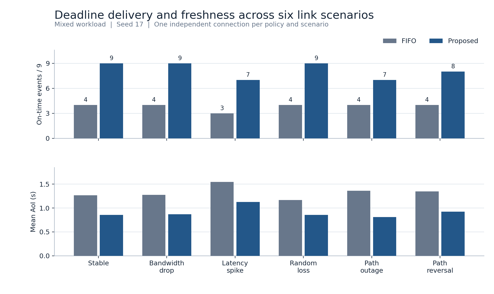

# IoT-MPQUIC-Scheduler

[English](README.md) | **简体中文**

**面向 IoT 流量的截止时间与信息新鲜度感知多路径 QUIC 调度。**

IoT-MPQUIC-Scheduler 在同一条 QUIC 连接上通过两条独立的 UDP 路径传输周期传感器状态和独立事件，用来评估链路条件变化时，联合记录调度与路径选择能否同时改善事件按时交付和状态新鲜度。

[实验结果](#实验结果) · [快速开始](#快速开始) · [复现实验](#复现实验) · [技术报告](docs/stage6-research-report.md)

## 工作方式

- **应用调度。** 尚未提交的传感器状态可以被更新值替换，事件保留独立 ID。联合策略使用接收端 ACK、信息年龄（AoI）、截止预算、事件严重程度和路径估计，并通过恢复配额和服务配额给状态更新保留提交机会。
- **路径调度。** 每条记录使用一个单向 QUIC Stream，初发绑定到一条路径。严格亲和模式沿原路修复，跨路径模式允许修复包走备用路径。服务端以完整接收记录的时刻判定截止，并通过独立的应用 ACK 返回结果。
- **对照实验。** 提供 FIFO、严格优先级、最早截止优先、AoI-aware、最新值替换加轮转五种基线。各策略可重放相同 seed 的负载，运行时记录两端日志及双接口抓包。

## 实验结果

| 对照 | FIFO 或控制组 | 联合调度 |
| --- | ---: | ---: |
| 六种链路条件的按时事件，混合负载，seed 17 | 23/54 | **49/54** |
| 同六种条件的等权平均 AoI | 1.329 秒 | **0.907 秒** |
| 高混合负载的按时事件，seed 17 和 29 | 两次均为 1/20 | **两次均为 10/20** |
| 定向中断探针完整接收，关闭与开启跨路径修复 | 1,529.6 ms | **338.0 ms** |



纯事件突发中，联合策略将按时数从 11/18 提高到 14/18，事件 P95 从 1.36 秒升至 2.34 秒。高混合负载下，有效状态交付的 Jain 指数低于 FIFO。跨路径修复使中断探针在 A 路恢复前完成接收，两种模式均超出探针的 25 ms 截止。

归档包含 **42 次运行、84 份接口抓包和 1,830 条输入记录**。 [技术报告与全部图表](docs/stage6-research-report.md) · [运行指标](results/stage6/runs.csv) · [逐记录数据](results/stage6/records.csv) · [配对差值](results/stage6/paired-deltas.csv)

## 快速开始

在支持网络命名空间、veth 和 `sch_netem` 的 Linux shell 中运行。归档实验使用 Ubuntu 24.04 WSL2。在项目根目录执行以下命令。

```bash
sudo apt-get update
sudo apt-get install -y build-essential git cmake ninja-build iproute2 iputils-ping tcpdump openssl python3
git submodule update --init
bash scripts/build.sh
sudo bash scripts/run-stage1.sh
```

快速测试会建立两条路径，在同一连接内反转链路条件，并将两路抓包与传输日志交叉核对。脚本会打印结果目录。 [环境配置与 WSL 构建路径](docs/experiment-environment.md)

## 复现实验

```bash
sudo python3 experiments/run_stage5.py results/runs/stage5-seed17 --seed 17
sudo python3 experiments/run_stage5.py results/runs/stage5-seed29 --seed 29 --suite high
sudo python3 experiments/run_stage5.py results/runs/stage5-repair17 --seed 17 --suite repair
```

每次运行会保存负载、`tc netem` 配置与切换时间、两端日志和两份抓包。安装 `tcpdump` 后可离线复核主矩阵。

```bash
python3 evaluation/verify_stage5.py results/stage5-wsl/seed17 --matrix
```

[实验配置](configs/stage5.json) · [指标定义与消融](docs/stage5-report.md) · [重建图表与数据表](docs/stage6-research-report.md#6-数据索引与复现)

## 项目结构

| 目录 | 内容 |
| --- | --- |
| `src/` | Gateway 队列、调度策略、XQUIC 端点和负载生成器 |
| `network/` | 双 veth 拓扑和定时链路变更 |
| `experiments/`、`evaluation/` | 实验矩阵、离线验收和绘图 |
| `patches/xquic/` | 对构建副本应用的可选 STREAM PTO 调度补丁 |
| `results/`、`docs/` | 原始证据、整理后的数据、图表及技术文档 |

## 实验范围

两条路径由同一台主机上的 IP 链路仿真提供。六种链路的主对照使用一个负载 seed，高负载对照使用两个。归档运行的 WSL 环境中，netem 的随机丢包序列随运行变化。两端使用相同的固定 XQUIC 构建，运行其 `XQC_MULTIPATH_10` 实现。 [XQUIC 版本与接口细节](docs/xquic-api.md) · [调度规则](docs/algorithm-spec.md)

## 许可证

项目代码和文档使用 [MIT 许可证](LICENSE)。XQUIC 和 BoringSSL 各自保留上游许可证。
