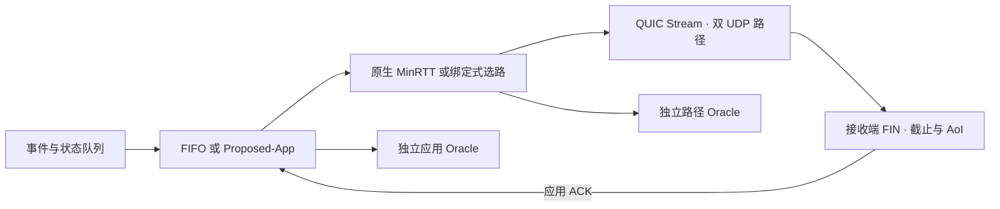
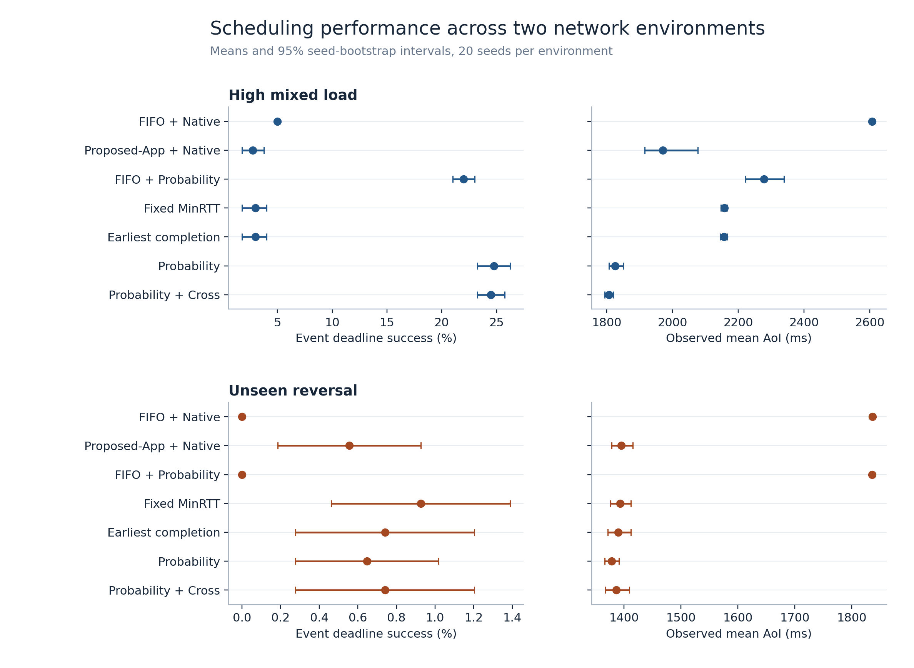

# IoT-MPQUIC-Scheduler

[English](README.md) | **简体中文**

**面向 IoT 流量的截止时间与信息新鲜度感知多路径 QUIC 调度。**

IoT-MPQUIC-Scheduler 在同一条 QUIC 连接上通过两条独立的 UDP 路径传输周期传感器状态和独立事件，用来评估链路条件变化时，联合记录调度与路径选择能否同时改善事件按时交付和状态新鲜度。

[实验结果](#实验结果) · [快速开始](#快速开始) · [复现实验](#复现实验) · [技术报告](docs/stage8-research-report.md)

## 工作方式



Proposed-App 使用接收端 ACK、截止预算、事件严重度和状态新鲜度，并在队列内替换旧状态。自定义路径策略为每条 Stream 绑定初始路径。严格模式沿原路径修复，跨路径模式可以在备用路径发送修复包。两套 Oracle 分别重放实际队列选择与初始路径选择。

## 实验结果

### Stage 8 · 独立验证与泛化

Stage 8 完成 **400 次正式连接实测**。配对实验使用 20 个新种子，随机路径探索使用另外 20 个种子。

- 高负载下，概率选路把事件按时率从两种严格亲和基线的 **3.00% 提高到 24.75%**。在新的反转场景中，优势不明确。
- 高负载的应用层与路径层交互为 **+5.00 个百分点**，Holm 校正后 `p = 0.0512`。
- 跨路径修复将中断探针的平均完成时间从 **1,544 ms 降到 253 ms**。原始概率模型在独立测试上未稳定优于仅用剩余预算的基线。



[研究报告](docs/stage8-research-report.md) · [逐次指标](results/stage8/runs.csv) · [校准图](results/stage8/figures/03-reliability.png) · [实验审计](results/stage8/audit.json)

### 历史实验

- **Stage 7** 分开评估应用和路径调度，完成 600 次正式实测，重点高负载有 20 个种子。 [研究报告](docs/stage7-research-report.md) · [归档审计](results/stage7/audit.json)
- **Stage 6 及之前** 保存 42 次动态网络和机制验证运行，包含双接口抓包和更早阶段的报告。 [Stage 6 报告](docs/stage6-research-report.md) · [Stage 5 报告](docs/stage5-report.md) · [文档目录](docs/)

## 快速开始

在支持网络命名空间、veth 和 `sch_netem` 的 Linux 环境中运行。归档使用 Ubuntu 24.04 WSL2。

```bash
sudo apt-get install -y build-essential git cmake ninja-build iproute2 iputils-ping tcpdump openssl python3
git submodule update --init
bash scripts/build.sh
bash scripts/test.sh
sudo python3 experiments/run_stage8.py results/runs/stage8-pilot --suite pilot --jobs 5
```

Pilot 会运行 20 次独立连接，并核对队列决策、路径决策、端点日志和双接口抓包。 [环境配置](docs/experiment-environment.md)

## 复现实验

在干净的代码 checkout 上构建后，运行完整配对和探索矩阵。安装 `evaluation/stage6-requirements.txt` 中的依赖可重新绘图。

```bash
sudo python3 experiments/run_stage8.py results/runs/stage8-paired --suite paired --jobs 8
sudo python3 experiments/run_stage8.py results/runs/stage8-explore --suite explore --jobs 8
python3 evaluation/verify_stage8.py results/stage8 --archive
python3 evaluation/stage8.py results/stage8/raw --out results/runs/stage8-recomputed \
  --figures --compare results/stage8
```

[实验配置](configs/stage8.json) · [实验计划](docs/stage8-experiment-plan.md) · [复现说明](docs/stage8-research-report.md#17-reproducibility-instructions--复现)

## 项目结构

| 目录 | 内容 |
| --- | --- |
| `src/` | Gateway 队列、调度策略、XQUIC 端点和负载生成器 |
| `network/` | 双 veth 拓扑和定时链路变更 |
| `experiments/`、`evaluation/` | 实验矩阵、离线验收和绘图 |
| `patches/xquic/` | 对构建副本应用的可选 STREAM PTO 调度补丁 |
| `results/`、`docs/` | 原始证据、整理后的数据、图表及技术文档 |

## 实验范围

两条路径为同一宿主机上的仿真链路，业务负载为合成重放。事件延迟分位数以窗口内完整交付为条件。路径概率校准来自随机分配的已观测路径，保留在线原公式。两端运行固定的 XQUIC `XQC_MULTIPATH_10` 实现。 [XQUIC 版本](docs/xquic-api.md) · [调度规则](docs/stage7-algorithm-spec.md)

## 许可证

项目代码和文档使用 [MIT 许可证](LICENSE)。XQUIC 和 BoringSSL 各自保留上游许可证。
