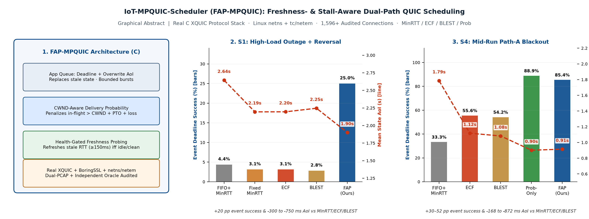
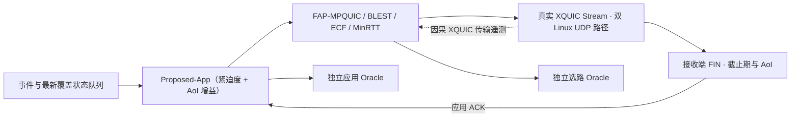
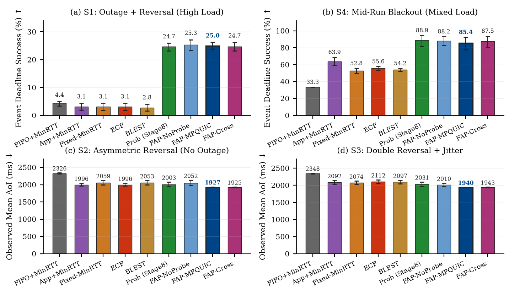
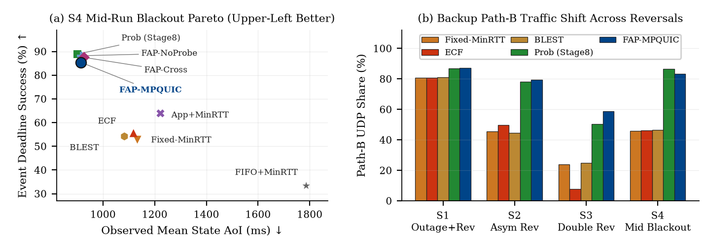
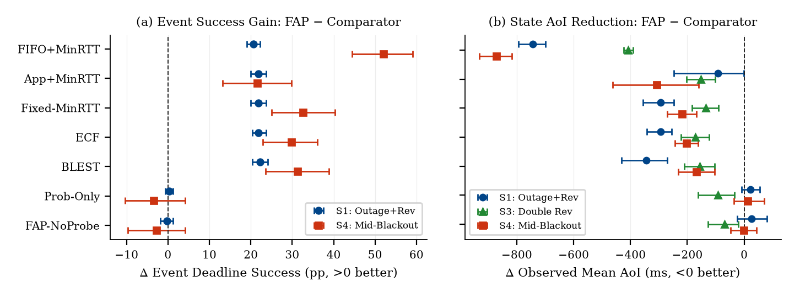
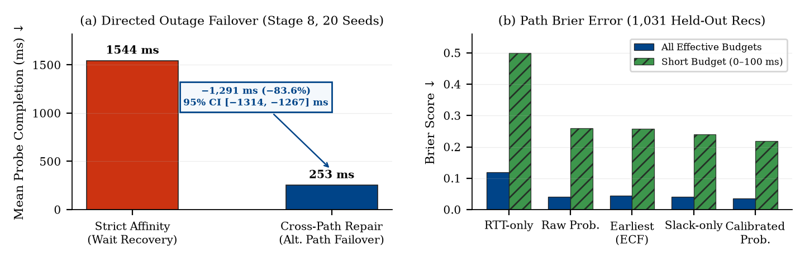

# IoT-MPQUIC-Scheduler

[English](README.md) | **简体中文**

**基于真实生产级 `XQUIC` 协议栈的新鲜度与阻塞感知多路径 QUIC 物联网调度器。**

IoT-MPQUIC-Scheduler 在同一条加密多路径 QUIC（`XQC_MULTIPATH_10` + `BoringSSL`）连接上，通过两条真实 Linux UDP 路径（`ip netns` + `tc-netem`）同时传输突发硬截止期报警事件与可覆盖周期传感器状态。项目提出了轻量级、零额外控制帧的 C 语言调度器 **`FAP-MPQUIC`**（`fresh-aware`），将覆盖新鲜度队列调度、拥塞窗口阻塞感知概率估计与健康门控陈旧路径新鲜度探测结合在一起。

[项目概览](#项目概览) · [架构与调度设计](#架构与调度设计) · [真实协议栈实测结果](#真实-xquic-双路径实测结果) · [快速开始](#快速开始) · [复现实验](#复现实验) · [IEEE 论文 (PDF)](papers/iot-mpquic-scheduler/manuscript.pdf)

---

## 项目概览

经典多路径调度器（如原生 `MinRTT`、`ECF` 与 `BLEST`）依赖历史缓存 RTT 与队列排空时间选路，忽略事件截止期余量、链路丢包、可覆盖信息年龄（AoI）以及空闲备用路径的陈旧 RTT 盲区。当网关主链路发生非对称反转或静默黑洞时，经典算法往往滞留在劣化路径上，导致关键 IoT 事件大量超时。

基于 **1,596+ 次审计过的真实 `XQUIC` 连接**（包含 4 种动态双路径场景 × 16 留出种子 × 9 策略 = **576 次配对实测**、双网卡 PCAP 抓包与双独立 Oracle 校验），`FAP-MPQUIC` 实现以下核心效果：

- **事件按时交付率提升 +20.6 至 +52.1 个百分点**：在高负载断路反转与途中主路径黑洞场景下显著优于 `FIFO+MinRTT`、`App+MinRTT`、`Fixed-MinRTT`、`ECF` 与 `BLEST`（$p_{\text{Holm}} \le 0.0230$，效应量 $d_z$ 最高达 `6.66`）。
- **途中黑洞场景（S4）三指标同时严格帕累托支配全部 4 个经典选路基线**：事件按时率（**+21.5–32.6 pp**）、平均状态 AoI（**−168.2 至 −307.7 ms**）与有效吞吐（**+8.9–9.8 kbps**）全部显著占优，且健康门控确保黑洞路径零探测浪费。
- **非断路单向/双向反转（S2、S3）取得全部 9 策略最低 AoI**：分别达 **1,927.0 ms** 与 **1,939.6 ms**（显著优于全部 5 个经典基线，$p_{\text{Holm}} \le 0.0034$）；在 S3 中还经 Holm 校正显著优于自身无探测消融 `FAP-NoProbe`（**−70.1 ms**，$p_{\text{Holm}} = 0.0123$），直接验证健康门控探测的因果收益。
- **完整学术与工程交付**：附带 8 页独立 IEEEtran 英文论文（含 2 条理论命题证明与 29 篇核验文献，[manuscript.pdf](papers/iot-mpquic-scheduler/manuscript.pdf)）、印刷级矢量图表及全套 C/Python 自动化测试。



---

## 架构与调度设计



1. **覆盖新鲜度应用队列（`Proposed-App`）**：按传感器覆盖旧待发状态、丢弃已被接收端 ACK 覆盖的过期记录，结合截止期余量、事件严重度、等待时间与潜在 AoI 改善打分，并通过有界突发/恢复配额防止状态饥饿。
2. **拥塞窗口阻塞感知概率估计**：实时读取每条活跃 `XQUIC` 路径的严格因果 `xqc_send_ctl_t` 计数器（`srtt`、`rttvar`、带宽、`cwnd`、`in_flight`、近期丢包、PTO），仅在实际在途字节超过拥塞窗口（`in_flight > cwnd`）时施加线性 RTT 阻塞惩罚，避免误伤慢启动阶段的健康备用路径。
3. **健康门控陈旧路径新鲜度探测（`FAP-MPQUIC`）**：当备用路径传输层 RTT 陈旧（$\ge 150\text{ ms}$）且路径干净空闲（`pto == 0`、`recent_lost == 0`、`in_flight == 0`）时，直接借用可覆盖状态流发包刷新传输层 SRTT（零额外控制帧），单次 QUIC RTT 即可发现链路反转，同时保证黑洞路径不浪费宝贵的 `MAX_STREAMS` 并发信用。
4. **严格亲和 / 跨路径修复与双 Oracle 审计**：严格模式在原绑定路径修复，跨路径模式允许备用路径接管重传；两套独立 Oracle 基于双接口 `tcpdump` 抓包逐条复核队列与选路决策。

---

## 真实 `XQUIC` 双路径实测结果

### 1. 动态双路径主评测矩阵（576 次真实连接，16 留出种子 × 9 策略）

在隔离 Linux `netns`/`tc-netem` 环境下运行真实加密 `XQUIC` + `BoringSSL` 端点，覆盖四种动态链路场景（`S1` 高负载断路+反转、`S2` 非断路非对称反转、`S3` 双向反转+12 ms 抖动、`S4` 途中主路径黑洞），全部 576 次运行 100% 正常完成，采用 5,000 次种子自助法 95% 置信区间、20,000 次符号翻转置换检验与全局 Holm-Bonferroni 校正：

| 场景（16 种子 × 9 策略） | `FIFO+MinRTT` | `App+MinRTT` | `Fixed-MinRTT` | `ECF` | `BLEST` | `Prob` | `FAP-NoProbe` | **`FAP-MPQUIC` (Strict)** |
| --- | :---: | :---: | :---: | :---: | :---: | :---: | :---: | :---: |
| **S1** 断路+反转 — 按时率 (%) / AoI (ms) | 4.4 / 2,644 | 3.1 / 1,993 | 3.1 / 2,194 | 3.1 / 2,195 | 2.8 / 2,246 | 24.7 / 1,878 | 25.3 / 1,875 | **25.0 / 1,901** |
| **S2** 非对称反转 — AoI (ms) / 吞吐 (kbps) | 2,326 / 109.8 | 1,996 / 111.0 | 2,059 / 104.5 | 1,996 / 112.9 | 2,053 / 102.5 | 2,003 / 113.6 | 2,052 / 106.8 | **1,927 / 117.3** |
| **S3** 双向反转+抖动 — AoI (ms) / Path-B 占比 | 2,348 / 32.8% | 2,092 / 30.9% | 2,074 / 24.0% | 2,112 / 7.9% | 2,097 / 25.0% | 2,031 / 50.4% | 2,010 / 49.2% | **1,940 / 58.9%** |
| **S4** 途中黑洞 — 按时率 (%) / AoI (ms) / 吞吐 (kbps) | 33.3 / 1,786 / 78.6 | 63.9 / 1,222 / 70.1 | 52.8 / 1,133 / 70.3 | 55.6 / 1,118 / 71.0 | 54.2 / 1,083 / 71.0 | 88.9 / 902 / 81.6 | 88.2 / 915 / 80.0 | **85.4 / 915 / 79.8** |

- **高负载断路+反转（S1）**：`FAP-MPQUIC` 事件按时率较全部 5 个经典基线高 **+20.62 至 +22.19 个百分点**（$p_{\text{Holm}} \le 0.0025$，$d_z = 5.43\text{–}6.66$），平均 AoI 较 `Fixed-MinRTT`/`ECF`/`BLEST`/`FIFO+MinRTT` 降低 **293.9–743.6 ms**（$p_{\text{Holm}} \le 0.0031$）。
- **纯非对称与双向反转（S2、S3）**：经典策略严重滞留在劣化 Path A（S3 中 `ECF` 仅将 7.9% 流量切往 Path B，`Fixed-MinRTT`/`BLEST` 仅 24–25%）。`FAP-MPQUIC` 取得**全部 9 策略最低平均 AoI**（S2 **1,927.0 ms**，S3 **1,939.6 ms**，$p_{\text{Holm}} \le 0.0034$），并在 S3 经 Holm 校正显著优于无探测消融 `FAP-NoProbe`（**−70.1 ms**，$p_{\text{Holm}} = 0.0123$）。
- **途中 Path-A 黑洞（S4）**：`FAP-MPQUIC` 在**事件按时率（+21.5–32.6 pp，$p_{\text{Holm}} \le 0.023$）、AoI（−168.2 至 −307.7 ms，$p_{\text{Holm}} \le 0.0063$）与有效吞吐（+8.9–9.8 kbps，$p_{\text{Holm}} \le 0.0072$）三项指标上同时严格帕累托支配全部 4 个经典选路基线**，且凭借健康门控零探测浪费与 `Prob` 统计持平（$p_{\text{Holm}} = 1.0$）。







### 2. 跨路径故障接管、离线概率校准与追踪完整性审计

仓库同时归档了 1,000+ 次机制验证与审计连接，刻画关键工程细节：



- **定向中断跨路径故障接管（20 种子）**：单流中断时，跨路径修复将探针平均完成时间从 **1,544 ms 降至 253 ms**（**−83.6%**，95% CI `[-1314, -1267] ms`），并将重复流偏移 UDP 字节从 `24.1 KB` 降至 `15.1 KB`。
- **离线概率校准与特征审计**：在 1,031 条随机路径测试记录上，离线 Platt 校准将有效预算 Brier 误差从 `0.0413` 降至 **`0.0355`**（0–100 ms 短预算由 `0.260` 降至 `0.218`），同时如实记录其在链路分布偏移下相对 `Slack-only` 的有限增益。另有 288 次连接（`6,072` 条带标签提交）完成端到端决策-抓包追踪链完整性、5 ms 切换精度与 ±5% Goodput 等效性审计。
- **应用层与路径层因子分离**：600 次因子实验与 400 次独立泛化运行完整拆解了应用层覆盖调度与路径层绑定的各自贡献。

[IEEEtran 英文论文 (PDF)](papers/iot-mpquic-scheduler/manuscript.pdf) · [中文技术报告](docs/stage10-fap-mpquic-report.md) · [汇总 CSV](results/stage10/summary.csv) · [配对统计 CSV](results/stage10/paired_effects.csv) · [泛化与校准报告](docs/stage8-research-report.md) · [数据质量与特征审计](docs/stage93a-data-quality-feature-analysis.md)

---

## 快速开始

在支持网络命名空间（`ip netns`）、`veth` 和 `sch_netem` 的 Linux 环境中运行（已在 Ubuntu 24.04 / Linux 6.x 与 Linux 容器验证）：

```bash
sudo apt-get install -y build-essential git cmake ninja-build iproute2 iputils-ping tcpdump openssl python3
git submodule update --init
bash scripts/build.sh
bash scripts/test.sh
```

运行 20 次连接的快速 Pilot（自动校验队列决策、选路决策、端点日志与双接口抓包）：

```bash
sudo python3 experiments/run_stage8.py results/runs/pilot --suite pilot --jobs 5
```

[环境配置说明](docs/experiment-environment.md)

## 复现实验

**1. 复现完整 576 次 `FAP-MPQUIC` 实测矩阵、矢量图与 IEEE 论文**

```bash
sudo python3 experiments/run_stage10_fap.py results/stage10 --jobs 6
python3 papers/iot-mpquic-scheduler/build_figures.py
cd papers/iot-mpquic-scheduler && tectonic manuscript.tex
```

**2. 复现泛化、故障接管与数据追踪审计**

```bash
sudo python3 experiments/run_stage8.py results/runs/paired --suite paired --jobs 8
sudo python3 experiments/run_stage8.py results/runs/explore --suite explore --jobs 8
python3 evaluation/verify_stage8.py results/stage8 --archive
bash scripts/test.sh --evidence results/stage91/final
python3 -B evaluation/stage93a.py results/runs/audit-recomputed
diff -rq results/stage93a results/runs/audit-recomputed
```

[实验配置](configs/stage8.json) · [论文构建说明](papers/iot-mpquic-scheduler/README.md) · [文档目录](docs/)

## 项目结构

| 目录 | 内容 |
| --- | --- |
| `src/` | 网关队列、`FAP-MPQUIC`/`BLEST`/`ECF`/`MinRTT` 调度器、`XQUIC` 端点与负载生成器 |
| `network/` | 双 `veth` Linux 命名空间拓扑与定时 `tc-netem` 链路变更 |
| `experiments/`、`evaluation/` | 实验矩阵运行器、自助法/Holm 统计校验与绘图 |
| `patches/xquic/` | 应用于 `XQUIC` 的 STREAM PTO 调度、完整性追踪与 RTT 测量补丁 |
| `results/`、`docs/` | 原始证据、整理后的数据表格、图表及技术报告 |
| `papers/` | 独立 8 页 IEEEtran 英文论文（`manuscript.tex`/`.pdf`）、29 条核验文献、绘图脚本与图形摘要 |

## 实验范围与局限

两端运行固定版本的生产级 `XQUIC`（`XQC_MULTIPATH_10`）+ `BoringSSL`，经真实 Linux UDP 套接字与 `tc-netem` 链路通信，但双命名空间位于同一宿主机而非多跳物理 Wi-Fi + 蜂窝空口；并发流信用固定为 $C=4$ 以暴露网关拥塞瓶颈；离线概率校准与在线选路目前保持解耦。[XQUIC 版本说明](docs/xquic-api.md) · [调度规则说明](docs/stage7-algorithm-spec.md)

## 许可证与关联研究栈

项目代码和文档采用 [MIT 许可证](LICENSE)，`XQUIC` 与 `BoringSSL` 各自保留上游许可证。

`IoT-MPQUIC-Scheduler` 属于可复现四层 AIoT 研究栈的 **L3 · 数据鲜度与弱网传输层**：

- **L1 · 可信感知：** [SensorTrust](https://github.com/Sver0411/SensorTrust)
- **L2 · 自适应观测：** [AdaptiveSense](https://github.com/Sver0411/AdaptiveSense) · [TAIS](https://github.com/Sver0411/TAIS)
- **L3 · 数据鲜度与弱网传输：** [EventGuard-LoRa](https://github.com/Sver0411/EventGuard-LoRa) · [NetAdapt-IoT](https://github.com/Sver0411/NetAdapt-IoT) · [IoT-MPQUIC-Scheduler](https://github.com/Sver0411/IoT-MPQUIC-Scheduler)
- **L4 · 故障韧性与 CPS 验证：** [EdgeFaultLab](https://github.com/Sver0411/EdgeFaultLab) · [TinyEdgeBench](https://github.com/Sver0411/TinyEdgeBench) · [Smart-Agriculture-Edge-AI](https://github.com/Sver0411/Smart-Agriculture-Edge-AI) · [AgriTwin-CPS](https://github.com/Sver0411/AgriTwin-CPS)
