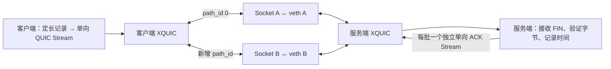
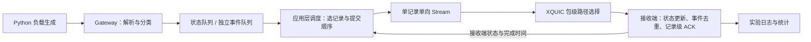

# 技术架构

## Stage 1 实现

一个 Linux 可执行文件包含客户端和服务端两种角色。每端一个 XQUIC engine、两个独立绑定并连接的非阻塞 IPv4 UDP Socket。两端共享单连接 ALPN `iot-stage1`。一个 `poll` 循环处理 Socket、XQUIC 定时器和应用进度。

初始连接从 A 发起。客户端收到可建路径通知后调用 `xqc_conn_create_path`，将返回的 ID 映射到 B。服务端从 `path_created_notify` 查询路径地址并匹配 B 的固定端点。两端用 `write_socket_ex` 给出的 ID 选 Socket。接收时，将 Socket 的真实本地及远端地址与单调时钟时间传给 XQUIC。XQUIC 用连接 ID 及路径状态处理 QUIC 数据包，Socket 日志另记物理入口。

每个阶段发送 64 条定长记录。每条 16,384 字节，前 4 字节为大端记录 ID，余下为可校验的确定性字节序列。客户端最多持有 16 个发送 Stream，`stream_close_notify` 释放该并发槽位。对端初始单向 Stream credit 设置为 32，XQUIC 通过 `MAX_STREAMS` 更新累计 credit。收到 `NULL` 时保留下一条待提交的记录并重试，超时退出会保留日志供定位。

服务端仅在收到完整 Stream 的 FIN 后校验内容和唯一 ID，随后记录单调时钟。每批 64 条都验证后，服务端用单独的单向 Stream 发送 4 字节批次 ACK。第一批 ACK 到达客户端后，实验脚本修改双向网络配置并发信号放行第二批。同一连接承载两个阶段。

## Stage 2 IoT 架构

应用层调度只决定哪些记录写入 QUIC 及提交顺序。传输层回调选择 QUIC 包的路径，一个 Stream 的不同字节可由不同包承载。状态替换只作用于应用队列里未提交的记录。Stream 已交给 QUIC 的字节受流控、有序交付、重传和关闭规则约束。

Stage 2 以独立 ALPN 增加带版本的状态、事件和 ACK 记录，并保留 Stage 1 的固定探针与性能反转实验。Gateway 将已到释放时间的输入加入队列，事件保留每次输入，状态替换可由策略启用。Stage 3 通过独立的调度模块选择待发记录。服务端在收到 FIN 后更新状态或去重事件，并用逐记录 ACK 返回处理结果和时间。格式、并发与 credit 规则见 [Stage 2 技术报告](stage2-report.md)。策略和反馈口径见 [调度算法规范](algorithm-spec.md)。
