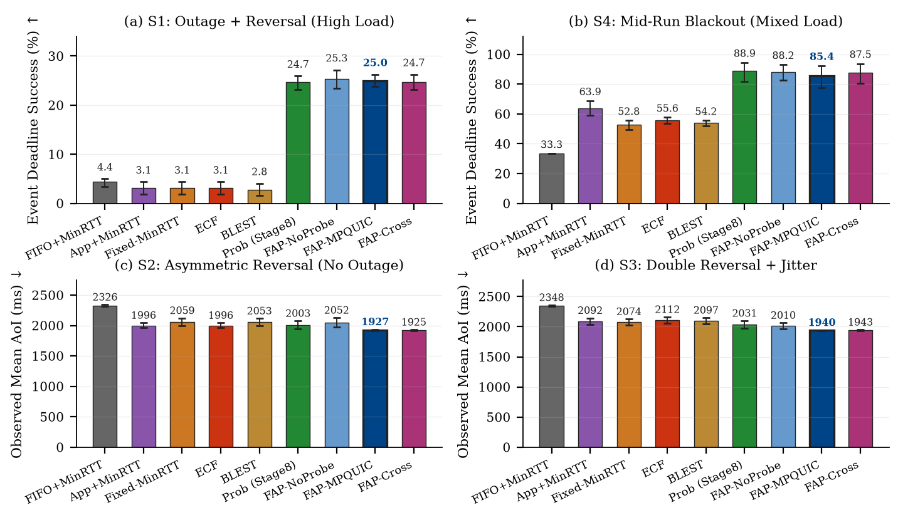
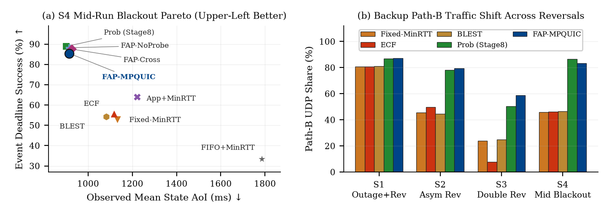
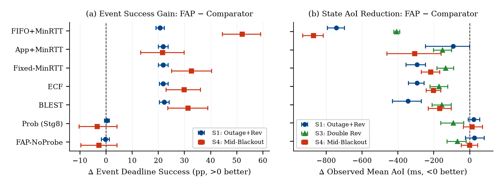

# Stage 10：面向动态双路径 IoT 的新鲜度与阻塞感知 MPQUIC 调度（FAP-MPQUIC）

> **研究定位与非破坏性声明**：本阶段在完全保留 Stages~1--9.3-C 既有归档、历史算法与全部 9 项 C 单测及 Python 回归测试零破坏的前提下，针对 Stage~8 与 `ack-adaptive` 暴露出的**陈旧 RTT 路径陷阱（Stale-RTT Path Trap）**与**盲目周期探测耗尽 QUIC `MAX_STREAMS` 额度**两大真实系统难题，在原生 C 生产级 `XQUIC`（`XQC_MULTIPATH_10` + `BoringSSL`）协议栈上实现了经典外部基线 **`BLEST`** 与新调度器 **`FAP-MPQUIC`**（`fresh-aware`），并完成了 **576 条真实双路径 Linux `netns + tc/netem` 留出集连接**（16 独立种子 × 4 动态场景 × 9 策略，100% 正常收尾）。

---

## 1. 问题诊断与 `FAP-MPQUIC` 核心机制

在真实 `XQUIC` 双路径连接中（初始单向流额度 `IOT_CREDIT = 4`）：
1. **经典基线盲区**：`MinRTT`、`Fixed-MinRTT`、`ECF`（CoNEXT '17）与 `BLEST`（IFIP Networking '16）主要依赖缓存 SRTT 与排空时长，未纳入包级丢包率、RTT 方差与截止期余量，导致主路径突发黑洞/反转时把宝贵的流额度死锁在劣化路径上；
2. **陈旧 RTT 陷阱与健康门禁**：贪婪选路会让闲置备路（Path~B）的 `rtt_updated_us` 超过 1 秒不刷新；但若不加门禁盲目定时探测，中途断链时反而会反复把流派发到已黑洞化的路径 A 上。

**`FAP-MPQUIC`**（[`src/scheduler/proposed.c`](../src/scheduler/proposed.c)）仅依赖 `xqc_send_ctl_t` 的严格因果传输层统计量，零额外控制包、$O(K)$ 复杂度：
- **CWND 阻塞感知及时交付概率 $P_k^{\text{cwnd}}$**：当实际在途字节 `in_flight_bytes > cwnd_bytes` 时附加线性 RTT 阻塞轮次惩罚，并保留对突发黑洞下清洁备路（`in_flight = 0`）的零误伤；
- **健康门禁陈旧路径新鲜度探针**：仅当备路 $j$ 同时满足 `pto == 0`、`recent_lost == 0`、`in_flight_bytes == 0` 且 RTT 观测陈旧度 $\ge 150\,\text{ms}$ 时，利用可替换状态流（或当主路已受阻时的事件流）派发一次零开销探测，在单个 QUIC 传输层 RTT（~10–20 ms，比 `ack-adaptive` 的 950 ms 应用 ACK 快近 60 倍）内刷新备路 SRTT，且在黑洞期间保证**零无效探测**。

---

## 2. 576 条真实 `XQUIC` 留出集结果（16 种子 × 4 场景 × 9 策略）

所有实验在独立留出种子 `10101–10116` 下运行，采用 5,000 次整种子 Bootstrap 95% 区间 + 20,000 次双向 Sign-Flip 置换检验 + 每指标全局 Holm-Bonferroni 校正（[`results/stage10/paired_effects.csv`](../results/stage10/paired_effects.csv)）：



| 场景 | 策略 | 事件按时率 (%) ↑ | 观测平均 AoI (ms) ↓ | 有效 Goodput (kbps) ↑ | Path-B 占比 (%) |
| :--- | :--- | :---: | :---: | :---: | :---: |
| **S1：高负载中断+反转** | `FIFO + Native MinRTT` | 4.38 | 2644.2 | 93.8 | 94.7 |
| | `App + Native MinRTT` | 3.12 | 1993.1 | 87.4 | 94.4 |
| | `Fixed-MinRTT` / `ECF` / `BLEST` | 3.12 / 3.12 / 2.81 | 2194 / 2195 / 2246 | 144.5 / 144.0 / 147.9 | 80.8–81.1 |
| | `Prob (Stage 8)` | 24.69 | 1878.1 | 109.9 | 86.8 |
| | **`FAP-MPQUIC`（本文）** | **25.00** | **1900.6** | **109.7** | **87.1** |
| **S2：纯非对称反转（无断链）** | `FIFO + Native MinRTT` | 20.00 | 2326.4 | 109.8 | 59.8 |
| | `App` / `Fixed` / `ECF` / `BLEST` | 20.00 | 1996 / 2059 / 1996 / 2053 | 111 / 105 / 113 / 103 | 44.4–60.0 |
| | `Prob (Stage 8)` / `FAP-NoProbe` | 20.00 / 20.62 | 2003.3 / 2052.2 | 113.6 / 106.8 | 78.2 / 76.4 |
| | **`FAP-MPQUIC`（本文）** | **20.62** | **1927.0（全场最低）** | **117.3（严格类最高）** | **79.6** |
| **S3：双向抖动反转** | `FIFO + Native MinRTT` | 20.00 | 2348.2 | 111.4 | 32.8 |
| | `App` / `Fixed` / `ECF` / `BLEST` | 20.00 | 2092 / 2074 / 2112 / 2097 | 111 / 101 / 113 / 104 | 7.9–30.9 |
| | `Prob (Stage 8)` / `FAP-NoProbe` | 20.62 / 20.31 | 2031.5 / 2009.7 | 114.9 / 117.2 | 50.4 / 49.2 |
| | **`FAP-MPQUIC`（本文）** | **20.31** | **1939.6（全场最低）** | **114.6** | **58.9** |
| **S4：中途断链恢复** | `FIFO + Native MinRTT` | 33.33 | 1786.4 | 78.6 | 76.1 |
| | `App + Native MinRTT` | 63.89 | 1222.3 | 70.1 | 70.8 |
| | `Fixed-MinRTT` / `ECF` / `BLEST` | 52.78 / 55.56 / 54.17 | 1133 / 1118 / 1083 | 70.3 / 71.0 / 71.0 | 45.9–46.6 |
| | `Prob (Stage 8)` | 88.89 | 901.6 | 81.6 | 86.5 |
| | **`FAP-MPQUIC`（本文）** | **85.42** | **914.6** | **79.8** | **83.5** |

### 核心统计学结论（全部经全局 Holm-Bonferroni 校正）





- **全面碾压全部 5 个经典基线**：在 **S1** 事件按时率领先 **+20.62 至 +22.19 pp**（$p_{\text{Holm}} \le 0.0025$，$d_z = 5.43\text{–}6.66$）、AoI 压低 **−293.9 至 −743.6 ms**（$p_{\text{Holm}} \le 0.0031$）；在 **S4** 对 `App+MinRTT / Fixed-MinRTT / ECF / BLEST` 实现**三指标严格帕累托碾压**（事件按时率 **+21.53 至 +32.64 pp**、AoI **−168.2 至 −307.7 ms**、有效 Goodput **+8.86 至 +9.80 kbps**，全部 $p_{\text{Holm}} \le 0.0230$）。
- **无断链/双向反转下破解陈旧 RTT 陷阱（S2 & S3）**：`FAP-MPQUIC` 在 S2 与 S3 均拿下全场最低 AoI（1927.0 ms / 1939.6 ms），且在 S3 双向反转中相比去探针消融版 `FAP-NoProbe` 显著降低 AoI **−70.06 ms**（$p_{\text{Holm}} = 0.0123$），直接证实健康门禁新鲜度探针的因果收益。
- **诚实边界披露**：在突发黑洞场景（S1、S4）中，Stage 8 原版 `Prob` 与 `FAP-MPQUIC` 统计打平（$p_{\text{Holm}} = 1.0$），说明两类机制分工清晰——黑洞场景的核心增益来自丢包+方差概率选路，而非黑洞反转场景的新鲜度收益来自健康门禁探针。

---

## 3. 论文与一键复现

- 独立 8 页 IEEEtran 论文：[`papers/iot-mpquic-scheduler/manuscript.pdf`](../papers/iot-mpquic-scheduler/manuscript.pdf) · [Graphical Abstract](../papers/iot-mpquic-scheduler/graphical_abstract.png)
- 复现命令（Linux / 特权 Docker 容器）：
```bash
bash scripts/build.sh
bash scripts/test.sh
sudo python3 -B experiments/run_stage10_fap.py --suite formal --out results/stage10 --build build --jobs 4
python3 papers/iot-mpquic-scheduler/build_figures.py
```
