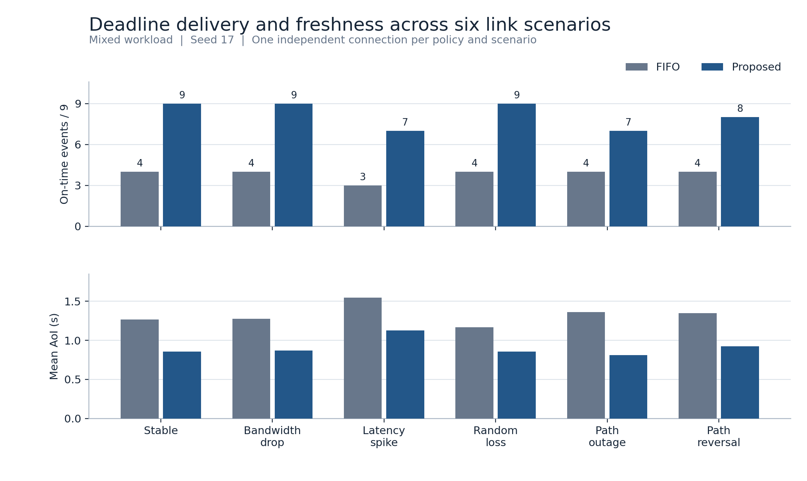
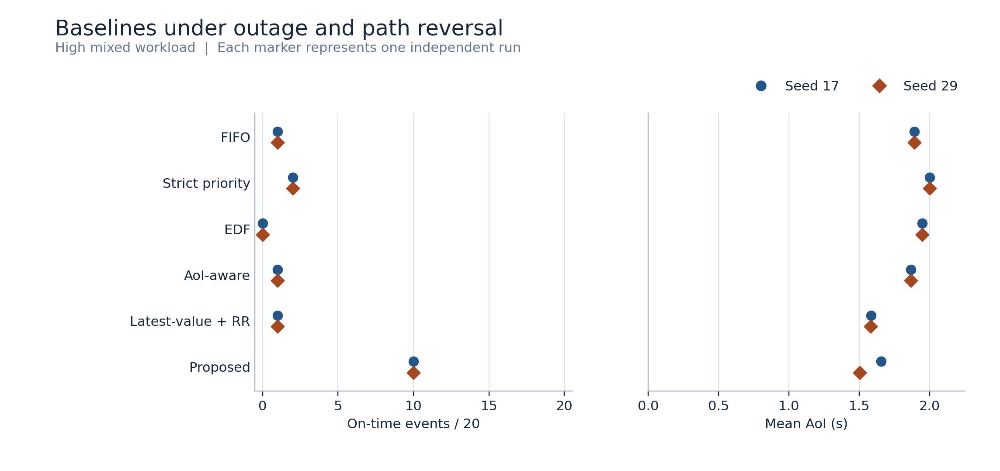
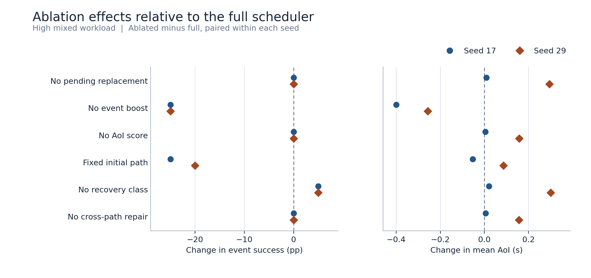
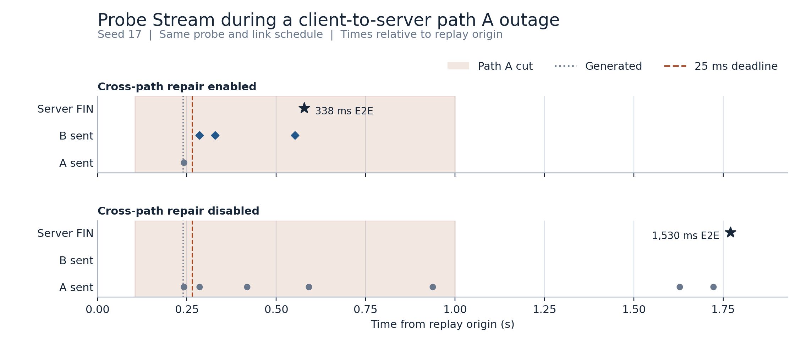

# 动态异构网络中的 IoT 时效性感知多路径调度

*Age- and Event-Priority-Aware Multipath Scheduling for IoT Traffic over Dynamic Heterogeneous Wireless Networks*

IoT-MPQUIC-Scheduler · Stage 6 研究技术报告 · 2026-11-07

## 摘要

周期传感器状态追求接收端的新鲜度，独立事件追求截止前完整到达。本项目在 XQUIC 上实现双层联合调度。应用层按接收端反馈、事件严重程度、截止预算和传输估计选取记录，传输层在真实的两条 UDP 路径上执行初发绑定与受控跨路修复。42 次 Linux 双路径实验涵盖链路动态、负载变化、基线、消融与定向中断。在 seed 17 的六种混合负载链路条件中，完整策略的按时事件从 FIFO 的 23/54 增至 49/54，六场景等权平均 AoI 从 1.329 s 降至 0.907 s。高负载结果呈现事件与状态之间的取舍。定向中断中，跨路修复使同一探针的完整接收从 1,529.6 ms 提前至 338.0 ms，仍超过刻意设置的 25 ms 截止。

## 1. 研究问题与设计

状态记录可能被更新版本替代。事件拥有独立 ID，需保留每次输入并由服务端去重。AoI 定义为时刻 `t` 与接收端已知最新状态生成时间之差 `t − u(t)`。一条记录即使传输快，若生成较早或到达时已有更新版本，对 AoI 的贡献也有限。状态新鲜度与事件截止因此需要分别评价。 [Kaul、Yates 与 Gruteser，IEEE INFOCOM 2012](https://doi.org/10.1109/INFCOM.2012.6195689)

实验围绕三个问题展开。

1. **RQ1** 在相同的周期状态与事件负载下，联合策略能否在链路条件变化时同时增加按时交付并降低平均 AoI？
2. **RQ2** 事件加分、待发状态替换、AoI 评分、动态初发选路及过期恢复在高负载下各有怎样的取舍？
3. **RQ3** 原路径已发出的 Stream 数据在中断后，允许修复副本跨路是否能提前服务端完整接收？

Gateway 在应用队列中按传感器替换尚未提交的状态，并用服务端 ACK 反馈的时间戳和序号识别过旧记录。创建单向 Stream 后，QUIC 管理该记录的可靠字节传输。服务端等到 FIN 和完整数据后记录接收时间，再通过独立单向 Stream 返回记录级 ACK。应用窗口、累计 `MAX_STREAMS` credit 和 QUIC 拥塞窗口分别控制不同的资源。 [架构](architecture.md) · [记录协议与时钟](stage2-report.md) · [QUIC Stream 与流控规范](https://www.rfc-editor.org/rfc/rfc9000)

联合策略按优先级、严重程度、等待时间、状态潜在 AoI 改善和估计按时概率评分。估计用到每条路径的 SRTT、RTTVAR、发送速率、在途与排队字节以及近期丢失。状态超过截止或最大年龄后，只要仍可更新接收端，就有独立的恢复分数。默认 `K=2`，每累计两次普通状态成功提交机会，可优先服务待恢复状态。连续提交三个事件后，有待发状态就先服务状态。配额约束的是成功提交机会，实际完整接收仍取决于信用、拥塞与丢失恢复。 [评分公式与参数](algorithm-spec.md)

初发路径在成功创建 Stream 后绑定。严格模式把 STREAM 数据及修复副本都留在原路径。跨路径模式仍绑定初发，原路遇到 PTO、拥塞阻塞或预计预算不足时，修复副本可选择满足拥塞窗口的备用路径。两种模式均保留接收端的有序字节交付。研究补丁只在启用研究调度器时把含 STREAM 的 PTO 副本交回路径回调。实验运行的是固定提交的 XQUIC `XQC_MULTIPATH_10`，验证范围为两个相同实现的端点。 [XQUIC 源码核查](xquic-api.md) · [QUIC 丢失检测与 PTO](https://www.rfc-editor.org/rfc/rfc9002) · [IETF Multipath QUIC draft-21](https://datatracker.ietf.org/doc/draft-ietf-quic-multipath/21/)

## 2. 实验与测量

实验平台为 Ubuntu 24.04 WSL2。两个 Linux 网络命名空间通过两对 veth 连接，各用独立的 IPv4 地址、UDP Socket 和真实 QUIC 路径。初始单向延迟及速率为 A 4 ms / 30 Mbit/s、B 24 ms / 12 Mbit/s。运行时通过 `tc netem` 修改指定出口。基线使用上游 MinRTT，联合策略执行上述路径估计和 Stream 绑定。各组共用固定 XQUIC 与 BoringSSL 版本、CUBIC、应用窗口 8、初始单向 Stream credit 4 和 24 包发送队列。 [环境与构建](experiment-environment.md) · [Stage 5 实验配置](../configs/stage5.json)

| 数据集 | 设计 | 实际运行数 |
| --- | --- | ---: |
| `seed17` | 六种链路条件的混合负载配对，稳定链路下纯状态与纯事件负载配对，高负载中断反转的五种基线、完整策略与六项消融 | 28 |
| `seed29` | 使用第二份高负载重放输入，重复基线与消融 | 12 |
| `repair17` | 共用一份探针负载，配对开启和关闭跨路径修复 | 2 |

按时率以服务端完整接收时间和各记录截止计算。事件按独立 ID 计数，状态按全部生成记录计数，包含应用队列中被替换或判旧的记录。平均 AoI 在 4 s 窗口内按实际接收更新积分，并对传感器等权平均。计算用虚拟的原点生成时间初始化状态。事件延迟的 P50、P95 和 P99 来自已完整接收的事件。数据集另外保留有效 payload goodput、Jain 有效状态交付公平性、每路径 UDP 利用、QUIC 检测丢失、STREAM 重发与两端 CPU。STREAM 重发用同一 Stream ID 与偏移的重复实际发送计数。 [指标口径](stage5-report.md#指标口径)

## 3. 基线对照结果



**图 1。** 每个场景有 9 个事件与 24 条状态，FIFO 和完整策略重放同一份 seed 17 输入。完整策略在六个场景都获得更高的按时事件数和更低的平均 AoI。合计按时状态为 FIFO 25/144、完整策略 48/144。六场景等权平均 AoI 相差 421.5 ms，约降低 31.7%。这些汇总描述六个场景内的观测。 [图 1 SVG](../results/stage6/figures/01-dynamic-scenarios.svg)

稳定链路的纯事件突发中，完整策略把按时事件从 11/18 提高到 14/18，但事件 P95 从 1.355 s 升至 2.338 s。这表明调度可以增加及时完成的事件数，同时使剩余事件等待更久。



**图 2。** 高负载中断反转，每个点是一条独立连接的一次运行。两个 seed 中，完整策略分别有 10/20 个事件按时。FIFO 为 1/20，严格优先级为 2/20。完整策略的事件 P95 为 7.945 和 8.206 s，低于 FIFO 的 10.236 和 10.239 s，高于严格优先级的 5.005 和 5.033 s。Latest-value + RR 的平均 AoI 在 seed 17 低于完整策略，在 seed 29 高于完整策略。 [图 2 SVG](../results/stage6/figures/02-high-load-baselines.svg)

高负载下，FIFO 的 Jain 有效状态交付公平性两次均为 1.000，完整策略为 0.476 和 0.516。该指数按各传感器最终有效状态交付比例计算，而 FIFO 两次的按时状态数均为零。交付比例接近与及时性相近是两个需要分别考察的目标。

## 4. 消融与跨路修复



**图 3。** 横坐标是关闭该项后的指标减去同一 seed 的完整策略指标。事件按时率使用百分点，AoI 使用秒。每个标记是一组配对观测。 [图 3 SVG](../results/stage6/figures/03-paired-ablations.svg)

| 改动 | 两轮高负载观测 |
| --- | --- |
| 关闭事件加分 | 按时事件均从 10/20 降至 5/20，按时状态分别从 3/33 和 5/33 升至 7/33，平均 AoI 下降约 400 和 257 ms。 |
| 固定初发路径 | 按时事件降至 5/20 和 6/20，但事件 P95 同时下降。动态选路的截止收益和整体尾时延在该负载中方向不同。 |
| 关闭独立恢复类 | 按时事件均增加一个，平均 AoI 分别升高 21 和 301 ms。 |
| 关闭 AoI 分数或待发替换 | 两种消融的按时事件均为 10/20，平均 AoI 在 seed 29 的升幅明显大于 seed 17。 |
| 关闭跨路径修复 | 两轮完整策略均未触发跨路修复。使用下述定向中断配对验证实际触发时的行为。 |



**图 4。** 色带由实际中断配置完成与恢复开始时刻绘制。发包标记来自客户端 XQUIC 日志，星号为服务端完整接收。相邻发送可能在图上重叠。完整模式在中断期间共发出 8 个跨路修复包，此图只显示首个探针 Stream。探针从生成到 FIN 分别耗时 338.0 ms 和 1,529.6 ms。跨路组在原路恢复前完成，两组均超出 25 ms 截止。 [图 4 SVG](../results/stage6/figures/04-cross-path-repair.svg)

## 5. 结论与适用范围

RQ1 在当前单 seed 的六种链路条件下得到一致的描述性结果。高负载下，事件加分、恢复机会和路径选择同时影响服务分配。RQ2 的两组 seed 表明，提高事件按时数可能牺牲状态新鲜度或公平性，而缩短事件 P95 也可能伴随更少的事件按时。RQ3 的定向用例证明固定 XQUIC 原型可以把修复流量实际发送到备用 veth，使特定 Stream 在原路恢复前完成。

证据的外推范围由以下条件决定。

- veth 和 netem 代表可控 IP 链路，实测结论限于该软件环境和已验证的 XQUIC 版本。无线链路、跨主机时钟和其他 QUIC 实现需要独立验证。
- 六种链路条件各用一份重放输入，高负载使用两个 seed，定向中断各模式一次。图中逐个展示观测点，统计检验和置信区间留待更大的重复样本。
- 当前 iproute2 支持设置随机丢包概率，原始丢失序列随运行变化。4 s AoI 窗口、虚拟初值以及高负载一次性恢复探针共同影响 AoI。后者使该子矩阵的全局峰值饱和在 4 s。
- 路径完成概率采用启发式估计，CPU 包含协议、日志、初始化和等待时间。高负载的窄应用窗口和 Stream credit 会放大排队效应。

## 6. 数据索引与复现

Stage 6 从 Stage 5 归档重算验收结果，逐条验证二进制负载、端点日志、路径发包、两路抓包和汇总，并输出以下可复查文件。

| 文件 | 内容 |
| --- | --- |
| [runs.csv](../results/stage6/runs.csv) | 42 个运行及完整指标，含执行顺序、源代码和二进制指纹、两份抓包的相对路径。 |
| [records.csv](../results/stage6/records.csv) | 1,830 条输入及最终处置，含负载长度和哈希、入队、提交、完整接收、ACK、截止标记和可用的 Stream 绑定。 |
| [paired-deltas.csv](../results/stage6/paired-deltas.csv) | 41 组同 seed 配对差值。差值方向为当前组减参考组。 |
| [repair-timeline.csv](../results/stage6/repair-timeline.csv) | 图 4 对应的原始探针事件、发包路径、偏移和时间。 |
| [source-sha256.txt](../results/stage6/source-sha256.txt) | 733 个 Stage 5 原始文件及汇总文件的 SHA-256。 |
| [audit.json](../results/stage6/audit.json) | 验收数量、数据集与图表清单。 |

`runs.csv` 的 `raw_run` 和 `capture_*` 以 `results/stage5-wsl` 为基准。逐记录表的联合键是 `dataset, case, record_id`，所有 `*_us` 时刻相对于本次重放原点，耗时也是微秒。未到达记录没有接收时刻、Stream ID 或 ACK，截止标志记为 0。Stage 1 至 Stage 4 的传输与算法验证数据随各阶段报告保留。

在 Linux 或 Ubuntu WSL 中使用 Python 3.12 和 tcpdump 离线重建。此步骤不需要 root，也无需重新运行网络实验。

```bash
python3 -m venv build/stage6-venv
build/stage6-venv/bin/python -m pip install -r evaluation/stage6-requirements.txt
build/stage6-venv/bin/python -B evaluation/stage6.py
(cd results/stage5-wsl && sha256sum --quiet -c ../stage6/source-sha256.txt)
```

要重新采集，先按 [实验环境](experiment-environment.md) 构建，再使用 [Stage 5 的三条采集命令](stage5-report.md#运行与复查)。把三组目录分别命名为 `seed17`、`seed29` 和 `repair17`，通过 `evaluation/stage6.py --source <归档目录> --out <新输出目录>` 复核并绘图。每次新采集都产生独立原始证据。
